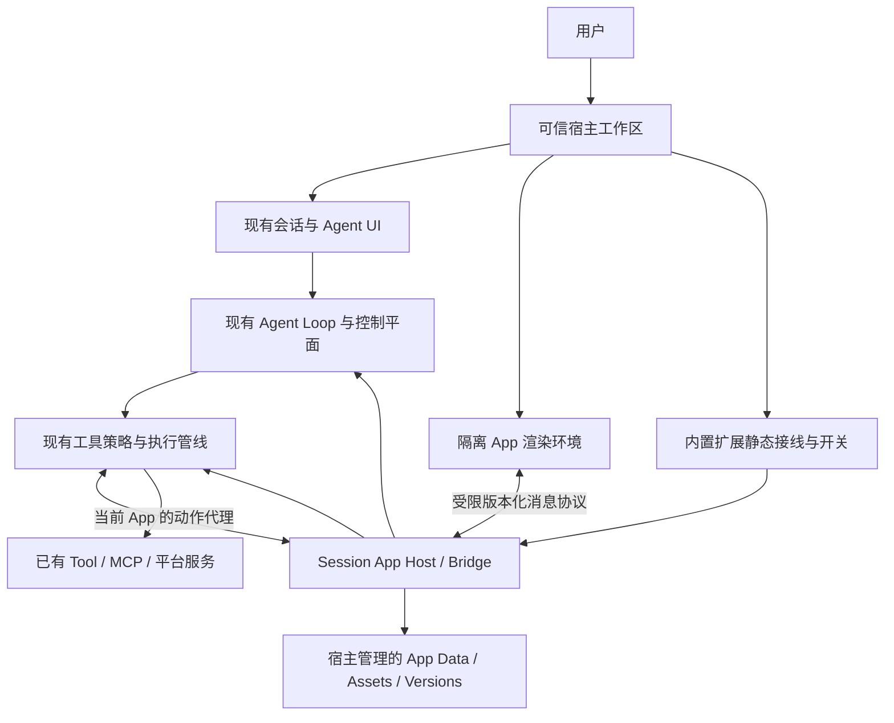
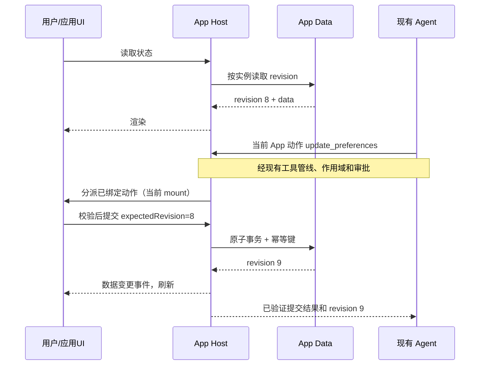
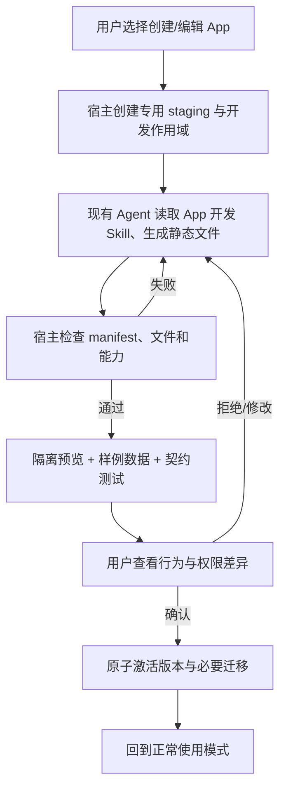

# Chatless Session App：产品需求、运行时设计与实施计划

> 联合计划 v1.0 · 2026-11-25 · 文档 B（会话应用）  
> 面向：维护者、产品/架构分析 Agent、实现 Agent、独立 Review 与测试 Agent  
> 配套：[文档 A · Chatless 内置扩展机制：需求与实施规范 v2.0](chatless-internal-extension-plan.md)  
> 状态：待实现与验证的方案。文中的 API、表名、预算和平台方案是建议契约或初始目标，不是已存在的功能或测试结论。

## 0. 读者须知与总体执行顺序

两份文档组成一个计划，不是两个互相独立的大型重构。A 解决官方可选功能怎样接入 Chatless；B 解决用户怎样在一个会话中创建、使用、保存及演进属于自己的应用。先完成 A 的最小机制及验收，再将 B 作为实际高级扩展进行开发。B 的源码审计与安全试验可以提前，但不得提前扩大 A 的公共接口。

| 阶段 | 任务 | 必须获得的证据 |
|---|---|---|
| A0–A4 | 内置扩展机制、试点迁移与依赖门禁 | A01–A17、资源预算、真实接入点 |
| B0 | 需求确认、现状审计、安全隔离可行性试验 | 已验证的宿主/应用安全边界；支持平台清单 |
| B1 | 最小应用宿主：布局、加载、桥接、持久化 | 固定测试应用能够安全运行和恢复；不会影响普通会话 |
| B2 | “今天吃什么”纵向闭环 | UI 与 Agent 双向操作、数据一致、恢复、两个实例隔离 |
| B3 | 生图工作台 | 复用同一 Runtime；真实服务与资产、进度、失败/取消闭环 |
| B4 | Agent 创建、预览、更新、迁移与回滚 | 不依赖维护者改 Chatless 源码即可生成与升级应用 |
| B5 | 发布准备与实验观测 | 全部适用 P0 门禁及性能报告，默认关闭、可退出 |

B1/B2 可以采用手写的测试应用，先证实宿主设计，再完成 B4 的用户自助创建流程；它们不是最终产品的全部功能。B3 验证宿主能否承载第二种真实需求，而不是另写一个只服务生图的系统。任何一阶段都要保持普通 Chatless 可构建、可用、可回退。

**执行原则：** 实施 Agent 首先分析仓库实际实现，指出设计不适配之处、可复用机制、最小必要改动和测试计划，再按阶段实施。允许调整具体接口和内部存储实现；不允许为了省事取消安全边界、绕过现有权限、删除验收项或改变产品目标。需要改变权威产品约束、扩大权限或引入大型依赖时，先提出明确的工程决策，等待维护者审批，不把提案当作全部功能已经获准。

## 1. 产品愿景与问题定义

### 1.1 核心需求

用户新建一个会话，选择“创建应用”，通过自然语言描述自己想要的软件，Chatless 中的 Agent 创建一个应用并在当前会话内完成本地部署。此后打开该会话，主要区域展示应用，右侧是原本的聊天与 Agent 交互界面。用户既可以直接操作应用，也可以通过聊天让 Agent 理解需求、查询或修改应用数据、调用工具、协助完成复杂任务，或者在明确的开发模式下改进应用本身。

应用代码、业务数据、资产、版本与对话均持久化。它不是一次性 HTML 消息，不是必须访问公网的网站，也不要求维护者为每一种个人应用修改 Chatless 源码。

例子：每天吃什么、图像生成/编辑工作台、个人读书记录、简单本地模型评测结果浏览器。首期只实现前两个验证应用，不因此承诺其余垂直功能。

### 1.2 为什么值得做

| 场景 | 单纯聊天 | 会话应用 |
|---|---|---|
| 高频确定操作 | 每次描述需求、模型推理 | 按钮、表单、筛选、直接编辑，无模型调用 |
| 业务状态 | 依赖对话历史或外部文件 | 结构化数据独立持久化，UI 与 Agent 同源 |
| 复杂需求 | 通过 Agent 执行 | 保留同一 Agent，附带明确的应用上下文 |
| 工具结果 | 一次性消息或文件 | 应用持续管理记录、作品、选择和进度 |
| 个性化功能 | 不断修改主程序或重写网页 | 用户主动请求生成新应用版本，预览后切换 |

**价值判断标准：** 用户完成长期重复任务所花费的总时间、操作次数、模型调用次数与返工次数是否下降；开发一个新的垂直应用是否不再需要改 Chatless 核心。不是以 App 数量、代码生成速度或平台覆盖率为主要目标。

### 1.3 产品定位与非目标

Session App 是 Chatless 的官方可选实验能力，默认关闭。它让已有的轻量本地 Agent 有应用式交互表面，而不是把 Chatless 变成通用低代码平台、IDE、云托管平台或应用商店。

| 必须做 | 明确不做（本计划） |
|---|---|
| 会话与一个本地 App 实例绑定；重启后恢复 | 多人协作、租户系统、公共应用市场 |
| 应用主体 + 真实右侧聊天，同一会话上下文 | 为 App 创建另一套 Agent Harness 或模型管理 |
| 受控静态 HTML/CSS/JS 与自定义交互 | 任意 npm 安装、后台 Node/Python 服务、Docker 部署 |
| 本地持久化、应用版本、受控升级 | 在线网站托管、公开分享 URL、远程执行代码 |
| UI 与 Agent 使用共同业务状态、显式动作 | Agent 必须模拟点击网页，或每次直接改 HTML |
| 受控 Tool/MCP/Agent 能力桥与权限复用 | App 直接拿到主程序 store、SQL、文件系统、密钥或 IPC |
| 低风险首期应用与第二个真实场景验证 | 通用工作流引擎、企业级多 Agent、全平台强行覆盖 |

## 2. 产品需求与交互规范

### 2.1 会话的类型与入口

- 保持现有“新建会话”默认行为完全不变。开启实验能力后，在新建入口提供“新建应用会话”或在新会话内显式选择“创建应用”。两种入口选其一，优先少增加导航层级。
- 新建应用会话进入空白创建状态：主区域提供名称、简单示例或需求输入引导；右侧复用现有聊天输入。用户输入“帮我做一个今天吃什么的应用”。先形成可预览候选，再由可信宿主确认激活；激活后自动进入应用视图，不需要用户另启服务器或手工部署。
- 第一阶段测试可由“从内置试验样例创建”进入；这只是 B1/B2 验证入口。B4 完成后必须支持从用户自然语言创建，而不能把最终产品限制为预置模板。
- 左侧继续使用现有会话导航、重命名、分组、搜索等能力。应用会话使用轻量标记区分；标题和 App 名称是不同概念，可以默认一致，不强制同步。
- 每个会话初期仅绑定一个 App 实例；每个实例初期仅绑定一个会话。不要设计多 App 标签页、共享 App 实例、独立全局应用中心。底层 ID 独立，为未来复制/重新绑定留下余地，不提前承诺这些功能。

### 2.2 工作区布局

```text
┌────────────────────────────── Chatless ──────────────────────────────┐
│ 会话导航       │ 应用工具栏：名称 · 状态 · 版本 · 权限 · 设置       │
│                ├──────────────────────────────────┬─────────────────┤
│ + 新建会话      │                                  │ 当前会话的 Agent│
│   普通聊天      │           应用主界面              │                 │
│ ● 今天吃什么    │         自定义 HTML / UI           │ 历史消息        │
│   生图工作台    │                                  │ 工具执行卡片    │
│                │    表单 / 按钮 / 记录 / 图片       │ 授权与审批      │
│                │                                  │ 聊天输入        │
│                ├──────────────────────────────────┴─────────────────┤
│                │ 可信宿主负责错误、进度、停止与版本操作              │
└────────────────┴────────────────────────────────────────────────────┘
```

- 应用占据主要可用区域，聊天是辅助入口。建议宽屏默认聊天宽约 320–400 CSS px（根据现有设计体系和最小窗口实测调整），支持调整宽度、折叠与恢复；不要把 UI 写成僵硬的固定像素布局。
- 小窗口不强制三栏并排：折叠会话导航，应用和聊天可切换；待审批/运行错误必须可见、可达。保留键盘导航与焦点管理，不能让不可信内容覆盖或伪造宿主审批界面。
- App 中的操作/数据变更及时反映在主界面；聊天中的工具卡片、取消、附件与模型选择仍使用原生 Chatless 功能。右侧是真实会话，不是 App 自建对话组件。
- 在宿主工具栏区分“使用应用”“编辑应用”“版本/权限”。普通使用中的任何聊天不能静默修改应用代码、权限、激活版本。
- 切换会话或折叠聊天不丢失已提交的数据。App UI 崩溃时显示宿主提供的恢复、重载、导出、回滚或切回聊天入口，不能让会话无法打开。

### 2.3 用户可见状态

| 状态 | 用户可以做什么 | 禁止行为 |
|---|---|---|
| 未创建/草稿 | 继续聊天、预览候选、放弃 | 候选擅自访问生产数据或调用真实服务 |
| 加载/启动 | 查看加载状态、取消 | 显示成功却尚未完成初始化 |
| 就绪 | UI、对话、应用动作 | 绕过当前审批/应用权限 |
| 升级预览 | 用隔离副本测试、查看版本与权限差异 | 静默覆盖当前版本与数据 |
| 暂停/禁用/不支持 | 读已有聊天、查看状态、导出/恢复（支持时） | 继续暴露该 App 的可执行动作 |
| 故障 | 查看原因、重载、回滚、返回聊天 | 自动丢数据、无限重启 |

### 2.4 典型完整用户旅程

**饮食应用：** 新建 App → 描述需求 → 生成并预览 → 确认启用 → 点击“换一道”不调用模型 → 点击“就吃这个”保存记录 → 在聊天中说“以后少油炸，多吃清淡的” → Agent 通过 App 专属动作更新偏好 → UI 自动刷新 → 关闭应用重启 Chatless → 饮食记录、应用版本和会话均在 → 进入编辑模式提出“增加每周统计” → 验证候选并升级 → 原记录保留。

**图像工作台：** 连接已配置且授权的生图服务 → 创建/打开工作台 → 选择模型、提示词、尺寸、seed → 点击生成 → 宿主显示任务进度 → 结果进入画廊 → 选中图片 → 右侧说“以这张为参考，把背景换成傍晚街道” → Agent 获取所选 asset ID 与必要参数，通过授权动作完成编辑 → 新作品入库 → 重启后可查看旧作品与任务结果。切换会话不会把 A 的图片附到 B；用户授权调用不代表同意将全部本地图片发送给云模型。

## 3. 系统架构：两种扩展边界不能混淆



箭头是逻辑调用关系，不要求全部新建独立类或进程。App Host 作为可信官方可选模块，按 A 的原则接入；App 内容本身只能见到 Bridge 协议，不能 import Host、Core 或 Extension API。Host 的能力权限高于 App，但不能替 App 绕过 Core。对 Agent 来说，App 动作是当前会话的受限能力，不是全局可信内置 ToolAdapter。对用户而言，聊天和应用都在一个工作区中，但底层的会话数据、代码版本、业务状态相互独立。

| 部件 | 职责 | 不能做的事 |
|---|---|---|
| Core（既有） | 会话、模型、AgentRun、工具策略与执行、审批、取消、数据库基础设施 | 感知具体饮食/生图 App 的领域逻辑 |
| Extension 接线（A） | 开关、惰性装载、有限的工作区入口、依赖门禁 | 将 App Bridge 变成所有扩展必须实现的接口 |
| Session App Host | App 实例、版本、挂载、能力绑定、请求校验、生命周期、任务状态及数据/资产 | 独立 Agent Loop、独立权限裁决系统、绕过审批直接执行外部工具 |
| Sandbox | 运行本地静态 UI 与业务逻辑、渲染与用户操作 | 主 DOM、直接原生 IPC、任意网络/文件/SQL/密钥 |
| App 业务代码 | UI、数据模型、领域动作及其说明 | 直接信任其他 App 的数据、无限制注册全局能力、隐式增加权限 |

### 3.1 已核实的仓库依据与待验证项

2026-11-25 查阅 `kamjin3086/chatless` main 树 `0716bc93e3d748fb337467e9e96913e9ea998bef` 及部分源码（具体分支实施前重新固定 commit，不是完整代码审计）。2026-11-26 在 main `62bc4de` 复核：上表全部入口仍存在、语义未变，main CI 全绿（单元 1760 passed / 6 skipped）；附录链接仍锚定 0716bc9 快照。A 中已列出工具与运行控制基础设施。B 增加如下依据：

| 现有入口 | 已观察到的事实 | B 应怎样处理 |
|---|---|---|
| `src/components/layout/ChatLayout.tsx` / `src/components/chat/ChatLayoutClient.tsx` | 已有会话侧栏、宽度与布局处理 | 在现有会话视图选择工作区，复用聊天组件；不重写全局布局 |
| `src-tauri/tauri.conf.json` | 主窗口 CSP 允许多种网络连接及内联/eval 脚本，`frame-src 'self'` | 不是不可信 App 的安全策略；不能直接放宽主窗口 CSP 作为接入方式 |
| `src-tauri/capabilities/main.json` | main 窗口具有 SQL、文件、HTTP 等原生权限 | 任何 AI 生成内容都不能继承此能力集合；原生 IPC 隔离必须实测 |
| `src/lib/documents/conversationDocumentService.ts` | 已有 `UnifiedFileService`、`DatabaseService` 及会话文档关联 | 评估复用文件和 DB 基础设施；App 资产不可直接继承普通聊天附件授权或自动索引 |
| `AgentRunControlPlane` / `AgentRunEventStore` | 已有运行身份、事件与持久化基础 | 复用现有运行/取消/审计入口，避免第二个 Agent 状态体系 |
| 工具组、`ToolsRegistryAdapter`、`ToolExecutionPipeline` | 已有按需发现、工具执行和审批 | 在 B 阶段补最小会话级动态动作视图与可信 UI 调用入口；不是第二个 dispatcher |
| `docs/agents/constraints.md` | 轻量、本地优先、可选包及禁止重写 Harness 的产品要求 | Session App 作为 Labs 审批；若现有约束与实际 Android 规划不同，由维护者另行更新 |

待审计：当前会话创建和删除 API、会话页组件与消息渲染边界、同步/备份行为、实际数据库事务与文件服务、实际工具审批上下文、平台 WebView 能力、已有 HTML 预览实现（不能假定存在或具备沙箱）。实施 Agent 须提交真实调用链、已有测试和最小改动点，不按示意目录机械搬迁。

## 4. App 定义、实例与运行生命周期

### 4.1 最小应用包

第一版仅接收本地静态文件。优先单一 HTML 入口或少量静态资源；由宿主校验与封装，应用运行时不自行安装依赖。允许静态 JS/CSS、图片/SVG（按内容安全规则）；不允许 npm 生命周期脚本、构建脚本、任意压缩包路径解压、远程 CDN 和动态代码下载。

```text
my-food-app/                    # 候选源码目录，不是 Chatless 源码目录
  manifest.json                 # 声明入口、SDK 协议、动作、能力、数据 schema
  index.html
  app.js
  style.css
  skills/                       # 可选，后续按现有 Skill 机制验证，不首期必做
```

Manifest 示例（仅定义语义，不要求字段名称一字不差）：

```json
{
  "format": 1,
  "name": "今天吃什么",
  "entry": "index.html",
  "sdkVersion": 1,
  "dataSchemaVersion": 1,
  "capabilities": ["state.read", "state.write", "agent.request"],
  "actions": [
    {"id": "get_preferences", "description": "读取饮食偏好", "effect": "read", "inputSchema": {"type": "object", "additionalProperties": false}},
    {"id": "update_preferences", "description": "更新饮食偏好", "effect": "app.write", "inputSchema": {"type": "object", "required": ["avoid"], "properties": {"avoid": {"type": "array", "items": {"type": "string"}, "maxItems": 30}}, "additionalProperties": false}}
  ]
}
```

Manifest 仅为申请与能力描述，**不是授权凭证**。宿主在安装/预览/升级时验证路径、格式、体积、动作名、JSON schema、能力是否受支持、版本兼容和用户授予范围。声明 `effect: read` 不等于可免审批或可重放；核心根据可信宿主规则和实际请求判定。对声明冲突、未知能力、非法路径、过大 payload 或不支持的协议明确拒绝，不静默降级到更多权限。

App ID、版本 ID、实例绑定、能力授权均由宿主生成和保存，不能接受 App 自己传来的全局身份作为事实。代码哈希用于版本完整性和审核差异，不代表代码可信。

### 4.2 生命周期与状态隔离

```text
create draft -> validate -> preview -> user activate -> ready
ready -> suspend/unmount -> resume/remount -> ready
ready -> edit draft -> validate -> isolated preview -> activate new version
                     -> reject/discard -> keep old active version
ready/error -> rollback (with schema compatibility check)
any -> disable / detach / export / explicit delete
```

- 使用已启用实例时，只有当前激活会话的 App 可以挂载；切换会话时解绑桥会话、动作、订阅和未完成的 UI 请求。B1 不要求多个隐藏 App 常驻，不支持跨会话背景执行应用 JS。
- App 动作在**已挂载且 ready**时才可调用。未挂载、刷新或初始化失败明确返回 APP_NOT_READY / APP_UNAVAILABLE，不将动作静默转发给 MCP，也不偷偷启动另一个 App。
- B1/B2 中切换会话或卸载时，取消尚未提交的纯 UI/动作请求。已被宿主成功接受的外部副作用任务不保证随 UI 卸载而终止；B3 规定真实后台任务的语义。任何已完成提交均保留，不能把超时误报成未执行。
- 禁用实验功能后 App 代码不运行，旧会话仍可打开聊天，数据原样保留；恢复功能应重新校验平台与版本。历史消息仍能显示原来的动作身份和结果，而不是重新执行动作。

## 5. 隔离与安全：第一道实施门禁

### 5.1 威胁模型

App 可能由模型错误生成，可能包含恶意代码、提示词注入、伪造 UI、外部链接、异常资源消耗，甚至试图读取 Chatless 密钥、其他会话、用户文件或控制设备。用户点击“创建应用”不等于同意执行任意本机代码。App 即使由用户亲自编写，默认也采用相同隔离策略。

需要保护的对象包括：主页面 DOM 与 store、Provider 凭据、会话及其他 App 数据、已授权目录、网络和本机服务、原生权限、模型输入、审批界面、宿主可用性。

### 5.2 安全可行性试验（B0）

**不要仅凭 HTML `sandbox` 属性或 CSP 字符串断言安全。** 现有 Tauri main 窗口已有较宽原生权限，App 内容必须证明无法继承。目标平台使用不同 WebView 引擎，需在最终安装/发布构建中做攻击探针，不能只用 Next.js 开发服务器或浏览器单元测试。

首选候选：在可信 UI 中嵌入隔离的静态内容渲染器，例如只允许脚本的 sandboxed iframe（不授予 same-origin、popup、top-navigation、forms、download 等权能），不可信内容使用独立安全上下文及由宿主生成的严格 CSP（默认拒绝资源，按需求仅允许经校验的本地静态脚本/样式、受限 blob/data 图片；禁止直接 connect、worker、object、外部 frame 等）。不允许 App 内容决定 CSP，不能使用同源 iframe 加 `allow-scripts allow-same-origin`，不能把 App HTML 注入主 DOM、使用 host `eval` 或直接加载为具有 main 权限的路由。

这一候选**必须**证明 WebView 原生 IPC、资源请求、导航/下载、协议 handler 和 app data 隔离有效。CSP 的 `connect-src 'none'` 不代表所有网络都被禁止；iframe 自身导航、元素请求、外部协议、不同 WebView 的注入机制等都可能形成绕行。需通过宿主级导航和网络拦截或更强隔离证明这些路径被拒绝。若同一 WebView 不能强制约束，采用独立受限 WebView/进程、无 main 原生权限、明确导航与请求控制的方案，再验证 Bridge 是否可用。不能做到则该平台不开放生成 App；如果所有目标平台都无法做到，则暂停 B，不能降级为主页面执行生成 JS。

安全隔离对 CPU/内存也有局限：同进程无限循环可能冻结宿主，`try/catch` 或超时 Promise 无法抢占 JS。需要实测异常 App 下宿主能否停止/卸载和继续聊天；无法达到故障隔离时，应使用可终止的隔离运行环境或缩小到可验证的受限渲染方案，而非承诺不存在的硬资源限制。B0 允许尝试两种候选，但不同时维护两套生产运行时。

首期支持：以维护者的主要桌面开发/使用平台为起点；桌面其他平台必须逐一通过安全及行为测试后才标记支持。Android 不作为首版交付的硬性要求，不根据 Tauri 跨平台声明推断可用；如果项目权威约束已更新，再独立验证对应 WebView 和触屏布局。平台不支持时保留聊天和数据，不加载不可信内容。

### 5.3 权限与可信来源

| 能力 | 默认策略 | 提升条件 |
|---|---|---|
| 读取/更新自己的普通 App 数据 | 用户启用应用时明确授予的实例作用域内允许 | 删除全部数据、批量不可逆操作由可信宿主确认；跨实例禁止 |
| App 资产读写 | 仅当前实例、额度内、经宿主校验 | 导入用户文件须通过宿主选择；导出/删除依风险确认 |
| 请求 Agent | 默认无后台自动触发；用户可见发起、可取消、限频 | 使用现有模型配置，可能产生费用或发送数据，明确范围 |
| Tool/MCP/外部服务 | 默认拒绝 | 只允许用户配置的具体连接与动作；执行仍走现有安全策略 |
| App 自定义动作 | 当前 App、版本、会话、挂载实例作用域内可见 | 动作输入/效果受宿主校验；不能自授额外能力 |
| App 代码/版本/能力修改 | 普通使用模式禁止 | 明确进入编辑/预览流程；新增能力和升级激活须确认 |
| 任意 SQL、目录、Shell、原生 invoke、密钥、任意 HTTP | 禁止直接暴露 | 不在本期 Bridge 能力范围；必要外部动作通过已有授权工具 |

权限是多层求交：App manifest 申请 ∩ 用户授权 ∩ 当前实例/版本/平台 ∩ 当前会话策略 ∩ 调用级审批与核心安全限制。任一层拒绝，不能执行。已有会话免问、目录 allowlist 和 MCP 权限不自动继承给应用；需要经应用能力授权及核心原有语义校验。App 也不能通过请求 Agent 或嵌套动作将自己没有的权限委托给其他调用。用户在可信聊天中独立发起的真实 Agent 请求与 App 代发任务应有来源标记和各自边界，不能混同。

## 6. Host Bridge：最小稳定接口与消息语义

核心目标是支持任意合法的前端界面，同时只给它完成任务所需的有限能力。不向 App 暴露数据库对象、内部 Store、AgentRunner、ExtensionContext，也不把宿主完整 Tool 目录塞给 App。

### 6.1 分阶段能力面

以下 TypeScript 是**协议说明**；实际可采用消息传输 SDK，不能在 App 进程/页面里直接持有可信宿主对象。

```ts
interface AppBridgeV1 {
  state: {
    read(): Promise<{ revision: number; data: JsonValue }>;
    commit(input: {
      expectedRevision: number;
      operations: StateOperation[];
      idempotencyKey: string;
    }): Promise<{ revision: number }>;
    onChanged(handler: (event: { revision: number }) => void): Unsubscribe;
  };
  actions: {
    bind(id: string, handler: AppActionHandler): Unsubscribe;
  };
  context: {
    setSelection(input: { assetIds?: string[]; label?: string }): Promise<void>;
  };
  agent: {
    request(input: { instruction: string; selection?: string[] }): Promise<{ runId: string }>;
  };
  // 以下仅在 B3 实现、平台及权限支持时暴露：
  assets?: {
    read(id: string): Promise<AppAssetHandle>;
    importUserFile(): Promise<{ id: string }>;
    export(id: string): Promise<void>;
  };
  tools?: {
    call(input: { capabilityId: string; arguments: JsonObject }): Promise<ToolReceipt>;
  };
}
```

`JsonValue`、`StateOperation`、`Unsubscribe`、`AppActionHandler`、`ToolReceipt` 等由实现者定义最小必要类型；上例不是可直接编译文件。B1 只需 state 与生命周期握手；B2 补 actions、选择上下文、Agent 请求；B3 才补资产与工具调用。不要因为示例有字段就先实现全部。

状态操作优先选择一个简单且可事务化的机制，例如对 JSON 文档做受限 `set`/`remove` 或键值更新；明确路径校验、原型污染防护、深度/大小限制、版本冲突语义，不提供任意 JSON 表达式执行。对高频更新使用订阅与节流，不轮询数据库、不把大数据全集塞进模型提示词。

`agent.request` 是用户可见的、进入现有会话发送/运行入口的请求，不是 App 自己调用模型端点。宿主展示任务来源、上下文与发送动作；App 不能伪造用户手势或把“点击随机推荐”伪造成允许向云端发送敏感数据。B2 默认通过宿主确认/发送入口发起，避免无限自动调用与 Agent↔App 自递归。App 动作执行期间禁止嵌套发起 Agent 请求，避免同一会话死锁、递归和费用失控。

### 6.2 通信协议

推荐请求/响应/事件三类消息，协议版本固定。例：

```json
{
  "protocol": "chatless-session-app/v1",
  "kind": "request",
  "requestId": "req-123",
  "method": "state.commit",
  "payload": {"expectedRevision": 8, "operations": [], "idempotencyKey": "cmd-123"}
}
```

宿主在握手时建立受限端口或信道，并将它绑定到宿主已确认的 appId、conversationId、activeVersionId、mountEpoch。请求中即使有这些字段，也不得用它们作为授权身份。采用 `postMessage` 时，不能只判断消息中的 token、`origin` 或自报的 appId；需要校验 `event.source`、期望窗口、握手状态及当前 epoch，优先在握手后使用专用 MessageChannel。对于 opaque origin 的沙箱，初始 `targetOrigin` 若因平台要求只能用 `*`，必须只向绑定窗口发送非敏感握手信息，不广播数据；后续采用受限端口。切换、刷新、升级、禁用后立即关闭旧端口并拒绝旧响应。

所有 RPC 使用显式方法 allowlist、输入/输出 schema、结构大小、深度、并发、速率及超时限制。宿主校验后才访问服务；禁止通过方法名反射调用任意函数，禁止 App 传入 callback 作为宿主可执行代码。错误返回结构化代码和可读说明，不暴露本机路径、堆栈、凭据或其他会话信息。

建议稳定错误码：`APP_NOT_READY`、`APP_DISABLED`、`UNSUPPORTED_PLATFORM`、`INVALID_REQUEST`、`UNKNOWN_METHOD`、`CAPABILITY_DENIED`、`APPROVAL_REQUIRED`、`CANCELLED`、`REVISION_CONFLICT`、`QUOTA_EXCEEDED`、`STALE_INSTANCE`、`TIMEOUT`、`OUTCOME_UNKNOWN`。不必先实现未使用的错误码，但不能用成功返回掩盖失败。

### 6.3 资源预算（初始建议，B0 可基于测量申请调整）

| 资源 | 初始限制 |
|---|---|
| 已挂载生产 App | 同一工作区 1 个；预览单独挂载时须销毁或隔离原 App，不能共享数据与桥 |
| 单应用静态源码 | 5 MiB（图片成果不计入），最多 100 个文件；不允许符号链接、路径穿越 |
| 单 RPC JSON | 256 KiB，深度最多 32；大资产走单独受限传输，不经 JSON/base64 无限放大 |
| 普通应用数据 | 5 MiB / 实例；超过时明确提示，不自动丢旧数据 |
| 并发桥请求 | 每实例最多 8 个，速率建议 30 次/秒，持续超限拒绝并可暂停应用 |
| 本地动作 | 默认 10 秒等待上限；取消/超时不等价于副作用未发生 |
| 生图任务 | 每实例默认最多 1 个进行中任务，可配置但总量有界 |
| 资产额度 | 默认 500 MiB / 实例（可由用户调整）；单文件上限建议 32 MiB，按实际服务和平台验证 |
| App 发起 Agent 请求 | 同一会话遵循现有运行并发限制；无递归，需用户可见操作 |

这些是建议的初始保守限额，不是已实测数据。必须能够在宿主真实执行路径实施；不能只在 App SDK 中校验。磁盘、内存及网络预算应包含候选预览、版本及失败重试的开销。

## 7. UI 与 Agent 的双向操作设计

### 7.1 单一状态来源

UI 点击与 Agent 动作使用同一个 App 的业务规则、同一个宿主数据接口及同一版本的数据。UI 不把状态只存于组件内存或 `localStorage`；Agent 也不维护一份独立“记忆”作为业务事实。对于选择、临时表单和滚动位置等纯 UI 状态，允许在隔离页面内保存，只有确有恢复需求才持久化。



这里的 App 动作 handler 仍运行于不可信沙箱。对普通 App 内部业务逻辑，它足够灵活；Host 负责验证作用域、输入、实际状态提交、资源和外部能力。App 返回“成功”不能成为外部动作、审批或数据提交成功的可信证明；对副作用型操作，Host 返回真实事务 receipt / 外部任务 receipt，失败时不伪造完成状态。

### 7.2 App 动作如何成为 Agent 工具

- Manifest 声明有限动作 ID、描述、参数 schema 和效果提示；宿主校验后，当前挂载 App 注册对应 handler。静态声明和运行时绑定一一对应，不能任意创建全局工具或覆盖 `fs`、`shell`、`tools`、`skill` 等保留名。
- 首期可采用一个保留的 `session_app` 工具组/适配器，例如 `session_app__get_context`、`session_app__list_actions`、`session_app__call_action`。`call_action` 由宿主根据**当前会话**的可信绑定解析 `actionId`，严格校验参数。若实际 registry 能安全支持当前会话动态 schema，亦可使用动态动作描述；禁止同时维护两套发现机制。优先固定少量工具和渐进式发现，避免每个 App 把全部 schema 常驻注入模型。
- 工具注册/发现、prompt/native 双轨、调用执行、计划模式、取消与历史展示走 A 已有统一通道。核心策略不能依赖 App 自称的 `effect` 决定只读或安全重放。默认保守：通用动作不得自动重放；计划模式只允许宿主可保证无副作用的查询能力。读动作执行过程中仍禁止调用写/外部能力；如无法保证，采用专门由宿主执行的只读数据查询，或不在计划模式开放。
- Agent 调用 App 动作仅在 ready 的当前 App 有效，切换后旧调用不得落到新实例。历史中记录稳定 appId/version/actionId 及安全摘要，不能存真实 token 或任意大数据。
- UI 动作可调用本地业务函数并通过同一状态桥提交；Agent 动作调用相同业务函数。不是 Agent 直接操作 DOM，也不是 UI 调用一个隐形模型来完成每个按钮点击。

### 7.3 动作上下文及权限传递

Agent 每次获取当前 App 的简短可信上下文：名称、激活版本、能力摘要、当前选中对象 ID、必要的时效/状态和动作发现方法。名称、业务数据、动作描述及 App 自带的文本都属于不可信内容，作为数据传入而不是高优先级系统指令。不得默认把 App 整个数据库、源码、所有图片、会话附件或秘密注入 prompt。模型需要细节时使用受控查询；向远程模型发送数据须沿用 Chatless 用户所选模型和已有发送边界，并让用户能够看见/纠正选择。

当 Agent 动作在 App 内运行时，宿主创建有界的调用作用域，标记 parent run/call、实例、版本、允许操作、取消状态。App 内普通自主 JS 不能伪装成该调用。若无法在不可信页面内区分调用者，**不得靠页面自报来源提升权限**：整个 App 的最大权限保持一致，Agent 动作额外受宿主规定的更窄上限，必要时使用单独专用通道或禁止嵌套外部动作。外部调用必须独立检查 App 权限和核心审批，不能继承“Agent 的批准”。

状态提交按 revision CAS（compare-and-set）和幂等键执行。并发 UI 与 Agent 写入时只允许一个旧 revision 成功，其余得到冲突并重新读取/明确重试；禁止最后写入覆盖全部新数据。幂等键按 appId、操作来源和请求作用域去重；相同键不同 payload 拒绝。模型或页面超时后先查询提交结果，不盲目重放写操作。

## 8. 本地持久化、资产、版本和数据恢复

### 8.1 数据模型（逻辑实体，不要求一实体一表）

优先复用 Chatless 的 SQLite、数据库迁移与文件基础设施。状态操作经宿主 repository，不开放 SQL 给 App。以下关系可结合现有数据层合并或实现，但语义必须清楚。

| 实体 | 关键字段 / 含义 |
|---|---|
| `AppInstance` | appId、名称、创建时间、activeVersionId、状态、有效数据 schema、当前 revision |
| `ConversationAppBinding` | conversationId ↔ appId；本期一对一唯一约束；与普通会话区分 |
| `AppVersion` | versionId、appId、父版本、manifest、代码/资源位置及 hash、sdkVersion、dataSchemaVersion、状态 |
| `AppState` | appId、revision、schemaVersion、JSON 状态（或小型 KV）、更新时间 |
| `AppGrant` | appId、授权能力、作用域、授权版本/条件、撤销信息；密钥仅保存于宿主原有凭据机制 |
| `AppAsset` | assetId、appId、受管路径/内容引用、MIME、大小、来源、创建时间、hash（如需） |
| `AppOperationReceipt` | 幂等键、payload hash、commit revision、状态；有界保留策略，不建立新的无限审计日志 |
| `AppJob`（B3） | jobId、appId、发起来源、外部任务 ID、状态、结果 asset IDs、错误、时间、取消/恢复信息 |

应用源码和大型资产放在宿主管理目录中，SQLite 负责元信息和事务性业务数据。文件名/路径由宿主生成并规范化，不能让 App 用 `../`、绝对路径、symlink 或自报 ID 读写其他位置。文件入库使用暂存、校验、原子移动或等效的崩溃恢复设计；文件系统和数据库不能假装有同一跨资源事务，需有清理/补偿机制。启动恢复扫描仅限 App 的受管区域，不能扫描整机。

### 8.2 数据提交规则

- 写入在宿主事务中完成：检查实例和授权仍有效、revision 相等、操作合法、容量限制，然后更新状态及 receipt。提交成功后再通知订阅者；通知丢失可重新读取 revision 恢复。不要每个 UI render 写数据库。
- 会话切换、App 重载和主程序崩溃后，最近一次成功提交的数据必须可读。未提交编辑应明确为草稿，不承诺跨进程保存未提交内容。
- App 数据和聊天历史独立。清理消息、聊天上下文压缩、归档会话不得删除业务数据或重放 App 操作。删除会话时宿主必须明确询问是否同时删除 App；默认保留 App 数据并给出恢复/重新关联或导出入口。若本期没有重新绑定 UI，至少提供明确导出或恢复被解绑会话的路径，不能产生用户无法访问的孤儿数据。
- 禁用不删除任何数据；移除应用需通过宿主确认（清楚显示影响），处理任务、版本、资产、权限、绑定；删除不自动删除用户原本从外部导入的源文件。
- 同步默认本地，不让 App 数据自动加入既有 WebDAV/跨端同步或知识库索引。备份/导出是显式能力；任何后续同步必须独立审查隐私、冲突、版本和大资产成本。

### 8.3 最小导出与恢复

B4/B5 提供可信宿主导出（受管源文件 + manifest + 当前业务数据 + 选定资产），不默认包含 API key、其他会话、授权凭证或内部日志。导出包格式、校验和版本标识清楚；导入默认创建新 appId、重新校验、重新授权，不复用原权限或伪造本机路径。导入与跨机器分享可延后为 B5 后续能力，但若导出已提供，至少提供同机可验证的恢复方法或明确说明为数据归档格式。不要开发应用市场、发布服务器或复杂同步协议。

### 8.4 版本、预览、升级与回滚

代码版本不可变；候选在独立 staging 区生成。验证通过后将文件移入受管版本目录，再在宿主事务中切换 activeVersionId。普通 App 使用时不能写自己已激活源码。

预览必须使用复制的状态或合成数据、独立预览实例/信道；默认无真实 Tool/MCP 权限、禁止外部副作用。用户确认前不能将预览修改写回生产数据。升级前显示源码/行为摘要、能力增删、数据 schema 变化和回滚限制；新增能力须重新授权，不因原版本已获准而自动授权。旧信道及旧动作在切换时立即失效。

数据迁移初期优先增量兼容、有限的确定性 JSON 转换（添加字段、重命名、默认值等）；不开放任意 SQL/迁移脚本。若新 schema 需要超出当前迁移能力，保留旧版本，报告不支持，不能强制重置数据。预览时在副本运行迁移并验证；激活时停止新调用、等待或明确取消相关任务、校验源 revision、保存迁移前快照，再在事务中执行经验证迁移和版本切换。失败保持旧版本、旧数据、旧有效授权。

回滚分两类：代码回滚（旧代码兼容当前 schema 且能力重新校验，保留最新业务数据）；数据回滚（确需恢复旧 schema，用户明确确认将丢失哪些新数据，先备份当前状态再恢复）。**不得因点击回滚而默认覆盖新版本期间积累的饮食记录或图片。** 未支持逆向迁移时提供导出、恢复快照等明确选择。保留版本/快照数量与体积有界，不能清理当前激活版本或唯一可恢复数据。

## 9. 两个验证应用：完整需求与共用机制

验证应用不是新的 Chatless 内置业务模块。它们应当是遵循相同 App 包格式、同一 Bridge 和生命周期的独立应用资产。允许维护者手写首版以确定契约，但 B4 最终必须证明 Agent 能以同样的方式创建或修改它们。业务代码不得 import Chatless 内部模块。

### 9.1 应用一：今天吃什么

**目标：** 验证低风险、纯本地应用，能够在不依赖模型的情况下完成日常操作，同时允许 Agent 理解和改变业务数据。

| 功能 | UI 入口 | Agent 能力 | 状态 |
|---|---|---|---|
| 食物候选 | 列表、新增、编辑 | 查询和补充候选 | 食物列表、标签 |
| 饮食偏好 | 偏好编辑表单 | 理解自然语言并更新偏好 | 不喜欢的食物、口味等 |
| 今日推荐 | 随机换一道、确认 | 按历史及条件提出推荐、设置结果 | 推荐 ID 与日期 |
| 饮食记录 | 查看、添加、更正 | 查询与记录 | 日期、食物 ID、备注 |
| 每周统计 | B4 升级后的统计视图 | 汇总历史、解释趋势 | 由已有记录计算，不重复持久化统计 |

最小数据示例（业务字段只是样例，不进入宿主 schema）：

```json
{
  "foods": [
    {"id": "f1", "name": "番茄牛肉饭", "tags": ["清淡"]},
    {"id": "f2", "name": "咖喱鸡肉", "tags": ["浓郁"]}
  ],
  "preferences": {"avoid": ["油炸"], "preferredTags": ["清淡"]},
  "today": {"date": "2026-11-25", "foodId": "f1"},
  "history": [{"id": "m1", "date": "2026-11-24", "foodId": "f2"}]
}
```

建议动作：`get_preferences`、`update_preferences`、`list_foods`、`get_history`、`add_meal`、`set_recommendation`。查询必须支持有界返回，不能把全部历史默认注入 prompt。记录与推荐区分，点击“换一道”不等于实际吃了；使用本地日期与显式时区处理，不由模型推断日期。

**实现方式示例（伪代码）：**

```ts
async function updatePreferences(input, commandId) {
  const snapshot = await app.state.read();
  const next = normalizePreferences(input, snapshot.data.preferences);
  return app.state.commit({
    expectedRevision: snapshot.revision,
    operations: [{ op: 'set', path: ['preferences'], value: next }],
    idempotencyKey: commandId,
  });
}

// UI 和 Agent 复用业务函数，Host 校验真实的提交权限与结果。
preferencesForm.onSubmit = (input) => updatePreferences(input, newCommandId());
app.actions.bind('update_preferences', (input, invocation) =>
  updatePreferences(input, invocation.commandId));
app.state.onChanged(() => refreshFromHost());
```

B2 必须实际测试：

1. 点击“换一道”和“就吃这个”，模型请求计数为 0；宿主可读最新状态。
2. 从聊天发出“以后少吃油炸”，现有 Agent 发现当前 App 动作，调用并获得真实提交 receipt；页面更新，历史仍在。
3. 在同一初始 revision 下同时发出 UI 写入和 Agent 写入；只允许一个直接成功，另一方处理冲突，不覆盖记录。
4. 关闭窗口并重启，数据、应用版本、会话关联保持一致；重复打开不重新生成初始数据。
5. 建立第二个饮食实例，修改它的偏好和记录，两个实例隔离；伪造另一实例 ID 仍不能访问。
6. 切换到普通会话，App 动作不再发现、不再执行；旧 pending 请求不能写入新会话。
7. B4 用同一 App 增加每周统计，并验证保留旧数据、预览隔离及回滚行为。

### 9.2 应用二：生图 / 改图工作台

**目标：** 验证复杂界面、大型二进制资产、外部服务调用、异步状态和自然语言辅助操作，证明 Session App 不是只适合纯本地小表单。

不绑定某一个特定图像模型或引擎协议。维护者已经使用的真实生图服务可作为首个连接器；实施前读取其实际 API 文档、认证、模型/参数能力、任务与取消方式。缺少真实服务配置时先用确定性 mock 测试 Runtime，真实服务接通后再验收，不宣称 mock 等于生产可用。不得因为本场景而将特定模型、引擎或 URL 写进 Core。

建议首版 UI：提示词和参数区、模型/操作类型（生图或改图）、参考图选择、生成/取消按钮、可浏览画廊、单张详情、任务进度及错误。参数以连接器真实 capability schema 为准：尺寸、steps、seed、CFG 等只在服务支持时提供；不能将某个引擎不支持的参数静默丢弃或伪造支持。

| 用户行为 | 经过的路径 | 不应发生 |
|---|---|---|
| 选择模型和参数、直接生成 | App UI → Host 授权调用 → Tool/MCP 或可信服务适配 | 每次点击先调用 LLM |
| 导入参考图 | 宿主文件选择 → 受管资产 ID | App 扫描本地磁盘、任意读路径 |
| 右侧描述修改要求 | 现有 Agent → 当前 App 动作/连接器 → 授权工具 | Agent 只能模拟点击或把图片发给错误服务 |
| 查看生成进度 | 可信宿主任务状态 → App 订阅/刷新 | 页面随机模拟百分比或将超时当成功 |
| 切换会话后回来 | 从持久化任务/资产读取 | 重复提交同一生图请求 |
| 保存结果 | Host 资产存储 → App 画廊更新 | 图片全集进入消息表或 prompt |

最小动作示例：`get_generation_settings`、`update_generation_settings`、`get_selected_image`、`list_images`、`submit_generation`、`submit_edit`、`get_job_status`、`cancel_job`。其中实际生成/改图必须走外部能力独立授权。模型可以决定如何修改 prompt，但不能未经用户授权将参考图发送给新的服务或扩大文件访问范围。

### 9.3 直接 UI 调用工具的接线（B3）

优先通过现有 MCP 或已批准的服务 adapter 实现图像连接器，App 只见到用户选定的有限 `capabilityId`，宿主将它解析为精确的 server/tool/参数约束。不要开放 `fetch(url)`、全目录 `tools.list()`、Provider 密钥或任意代理接口。服务地址与密钥由可信宿主配置；地址包括私有网络时必须是用户有意配置的目标，阻断未授权的目标、重定向、地址混淆及任意内网访问；按连接器实际传输方式做 SSRF 和响应大小测试。

需要审计现有 `ToolInvocation`、ToolCard、会话审批及 Pipeline 是否能够接受**可信 UI 来源**。如果当前只能处理模型发起的调用，则只增加一个窄的来源适配入口，由宿主构建真实调用身份、绑定当前 App/会话，复用现有的权限判定、调用级授予、审批 UI、执行与结果语义。不得伪造 assistantMessageId、假装模型发起过调用、给 App 一个可直接执行 adapter 的通道，或为生图再做一份安全策略。若不能安全复用，B3 先只开放 Agent 调用的外部动作，明确直接 UI 路径尚未验收；随后修复公共接线再交付完整工作台。

应用数据中保存服务连接 ID、模型和参数，不保存服务凭据。工具结果中的图片通过可信宿主入库并返回受限 asset ID；响应内容、文件扩展名、MIME 及体积都应校验。App 读取图片时返回短生命周期、限实例的内容句柄或受限字节流；不得返回任意本机文件 URL。UI 展示图片不意味着已获准向远程模型或另一个生成服务传输。

### 9.4 长时间任务（B3 的有限任务管理，不是通用 Scheduler）

生成操作可能等待数十秒或更久；页面卸载、切换或进程关闭不能成为重复生成的理由。优先复用现有运行控制面与持久化机制，只有缺少外部长任务句柄时才增加窄的 `AppJob` 支持。

```text
queued -> running -> succeeded | failed | cancelled | outcome_unknown
                    -> cancel_requested -> cancelled | succeeded | outcome_unknown
```

- `jobId` 由宿主分配，创建记录后再提交，保存幂等键和服务返回的外部任务 ID；外部服务不支持幂等时，明确存在提交结果不确定窗口，不能承诺 exactly-once。
- 取消分为“宿主停止等待/轮询”和“外部服务已确认取消”。只能在后者得到真实确认时显示任务已取消。服务不支持取消时应显示不可取消或停止等待，不虚构能力。
- 如果宿主仍在运行且已授权任务由可信宿主管理，切换 App 可以继续追踪；但不允许隐藏页面自行保持后台执行。退出进程后只有服务支持查询/恢复且仍获授权时才恢复跟踪；否则记录 `outcome_unknown`，由用户决定下一步，不自动重放。
- 生图结果持久化与任务完成状态应具有可恢复的一致性：先安全保存资产再提交结果索引，或使用可补偿的流程。重复完成通知不得生成重复作品记录。
- 禁用 Session App 或撤销授权时停止新请求、释放订阅，按用户选择处理正在运行的任务；外部已产生的副作用不能假装被撤销。

### 9.5 两个应用共同验证什么

| 需求 | 饮食 | 生图 | 必须共用 |
|---|---|---|---|
| 会话工作区、创建与挂载 | 是 | 是 | App Host / 布局 / 版本 |
| UI 与 Agent 共享数据 | 是 | 是 | state / action / context 契约 |
| 本地持久化、重启恢复 | 是 | 是 | 宿主存储与实例隔离 |
| 外部服务、审批与副作用 | 无 | 是 | 现有 Pipeline 与有限桥接 |
| 大型资产与长任务 | 无 | 是 | B3 按需新增窄原语 |

B3 允许为首次出现的资产/长任务需求增加通用受限能力，但**禁止**为生图工作台修改 Agent Loop 的领域行为或在宿主布局增加 `if (appName === 'image-studio')`。完成 B3 后用第二个极小的资产/任务测试 App 或夹具证明这些原语可复用；不要为了第二个样例开发完整的第三款产品。

## 10. Agent 创建与迭代应用（B4）

### 10.1 创建工作流

初始运行时通过手写 App 验证，但最终目标是用户无需修改仓库即可创建 App。B4 复用已有文件生成、工作区、模型、Skill 等能力，辅以一个专门说明 App 格式与宿主 API 的内置 Skill 或开发指引。它应在编辑模式按需提供，普通聊天不承载完整开发文档。



- Agent 可以写入本次 App 的专用 staging 目录；使用现有授权与路径规则，不允许它因为“正在做 App”而获得任意 shell、主程序源码目录、用户家目录、其他 App 或生产数据权限。需要读取已有 App 源码时由宿主提供当前版本的只读候选副本。
- 默认不运行生成的 npm install、构建脚本或任意代码；静态 App 不依赖在线 CDN。宿主生成必要的 SDK 引导资源，Agent 编写的业务代码遵循约定。未来若需要框架构建，另立需求验证其依赖供应链与权限，不能偷渡进本期。
- 宿主提供少量专用开发操作（例如校验候选、打开预览、列出差异、申请激活），通过现有 Agent 工具系统或可信 UI 使用。`activate` 不是普通业务动作，不能仅由模型宣布成功。
- 生成失败时保留候选源码、可读诊断和用户意图，允许 Agent 修正；不得自动修改 Chatless Core 来迁就某个 App 的错误代码。
- 自动校验包括文件及 manifest schema、允许能力、动作声明/绑定、启动握手、状态操作、资源错误、预览中的 smoke test。静态分析不能证明 JS 无害，安全依赖隔离和宿主约束。

### 10.2 开发模式与使用模式对照

| | 使用模式 | 开发模式 |
|---|---|---|
| 聊天任务 | 查询、修改业务数据、操作工具 | 创建或改变 App 代码、能力及 schema |
| App 文件 | 当前版本只读 | 专用 staging 可写 |
| 业务数据 | 当前实例真实数据、受控动作 | 默认副本或合成数据；生产只读摘要按需且经授权 |
| 工具权限 | 当前实例已授权能力与现有审批 | 不自动继承业务/生产权限；明确开发作用域 |
| 生效方式 | 合法事务立即生效 | 候选验证、预览、明确确认、版本切换 |

例如“把我今天的晚餐改为牛肉面”是使用任务；“新增每周统计页面”是开发任务。若用户在普通模式提出开发请求，可信宿主提供进入编辑模式的明确入口；不要要求模型独自判断后直接覆写生产文件。App 自己的页面也不能通过按钮伪造版本激活。

### 10.3 开发 Agent 的最小 App 指南（应随 B4 交付）

指南应包含：包结构、可用 Bridge 版本和能力、manifest 示例、状态事务与冲突处理、动作注册及 context、图片/工具权限、错误码、如何本地预览、禁止使用的 API、升级与迁移示例。提供一个无需理解 Chatless 主仓库即可复制的最小可运行 App，以及一个生图连接器的接入示例。指南须与实现同步，以自动化契约测试约束；禁止维护一份已漂移的“万能 SDK”文档。

最终验证任务：向一个未参与 Runtime 开发的 Agent 仅提供 App 指南、可用工具和需求，让它创建一个可用饮食 App、保存几条记录、关闭重开，再新增每周统计。它不应阅读或修改 Chatless Core，也不应需要维护者手动运行开发服务器。允许用户在可信预览/权限/激活步骤明确确认。

## 11. 实施细化与交付顺序

### B0：现状审计与可行性验证

交付独立分析记录：实际 SHA、产品准入回答（文档 A 及仓库约束）、支持平台、布局接点、数据/资产/工具接点、与 A 的交接差异、两个应用最小需求、威胁模型、可行性试验结果、性能基线和建议 PR 顺序。

安全试验必须运行恶意静态样例（读取 parent、调用原生 invoke、网络与导航、跨实例请求、伪造消息、死循环等）。B0 允许只写隔离试验或测试夹具，不把未经验证的生成页面接入正式主窗口。**没有实际安全证据，不进入 B1 生产接线。**

### B1：最小 Runtime 与可信工作区

- 复用现有会话导航及聊天组件，增加一个明确的可选应用型工作区入口；不新增通用 UI 插槽框架。普通聊天路径不加载 Runtime 的重模块。
- 绑定、实例、版本、持久化状态与 sandbox mount/unmount；静态样例从本地加载，Bridge 只开放 state、握手与必要的错误/取消。
- 加入宿主启用、关闭、重载、异常恢复及数据删除确认；建立迁移和回退安全性。应用执行尚未通过安全门禁的目标平台保持禁用。
- 交付：最小样例、启动/重启/切换录屏或截图、数据库持久化证据、关闭零活动资源、恶意 App 测试、普通聊天回归。

### B2：Agent 协作与第一个真实应用

- 增加最小的 App 动作绑定/发现/调用和选择上下文、Agent request 入口；用 A 的工具契约和现有 Pipeline 验证 native/prompt 双轨。对 App-origin 调用与普通用户聊天明确标记来源。
- 完整实现“今天吃什么”的低风险功能，验证 UI 无模型操作、自然语言操作、事务并发、隔离和故障恢复。优先小型清晰的业务代码，不为推荐算法引入额外模型或依赖。
- 交付：真实 App 包、测试用数据、验收录像或端到端日志、A 的相关回归、第一条真实扩展接线案例与核心改动 diff。

### B3：第二个真实应用及必要能力

- 先审计实际生图服务，选择一种最小连接方式。补资产访问、授权 UI 调用、可信任务状态；不要先实现任意后台服务管理器或通用媒体系统。
- 完成生图/改图、画廊、参考图、参数和进度。验证外部失败、取消、重启/恢复、授权撤回、结果体积和平台限制。
- 交付：真实连接器测试、mock 回归、可运行 App 包、任务/资产恢复证据、第二个通用原语夹具、对比饮食 App 的共享能力与新接线。若连接器尚未提供，真实服务验收 NOT RUN，本阶段不宣布完成。

### B4：自然语言创建与升级

- 实现 staging、开发作用域、App 指南/Skill、校验、隔离预览、激活/权限差异、有限迁移、代码回滚与数据恢复。不得把整个 IDE 搬进应用会话。
- 用真实 Agent 自主创建饮食 App，保留数据地新增统计；演示生成或修改生图工作台的可行性。验证权限增加拒绝、失败升级保留旧版本。
- 交付：非 Runtime 开发 Agent 的可重复使用步骤、原始测试记录、预览/激活/回滚证据、导出恢复说明；使用者无需编辑主仓库。

### B5：发布与观测

- 完成所有适用验收项、生产构建和目标真机测试，记录运行成本及剩余限制。默认关闭，明确 Labs 标识、支持平台、授权范围、数据路径和退出方式。
- 按仓库产品约束进行实验观测；跟踪用户自愿反馈的重复使用、任务完成率、操作次数、模型调用和资源成本，不为指标新增未经同意的遥测。
- 后续是否成为正式可选能力，由维护者依据使用证据决定。若用户实际上只需普通工具或一次性 HTML，应缩小 Runtime，不因为已经写了代码就强行毕业。

### 11.1 PR 与代码组织原则

建议每个阶段拆为一个或若干小 PR，每个 PR 可构建可测试。B0 安全试验可独立保留；B1 数据迁移/隔离与工作区接线若必须原子提交，可合并。B2 Agent 动作与样例配套，B3 资产和任务能力与连接器分开 Review，B4 版本升级与生成工具分开验证。

逻辑目录示例（非强制移动现有源码）：

```text
src/lib/sessionApp/             # 官方可信 Host / 状态与版本 / Bridge
src/components/sessionApp/      # 可信工作区、预览、权限与故障提示
src-tauri/...                   # 仅在安全验证所需时加入窄原生接线
examples/session-apps/food/     # 独立静态 App 包，不 import Host
examples/session-apps/image/    # 独立静态 App 包
```

实际目录由项目习惯决定。只有组装入口可以同时知道 Core 和具体 Host 实现；Core 不得 import 两个业务 App；App 不得 import 主程序内部接口。桥协议实现必须可单独测试。禁止新建通用插件 loader、全局事件总线、重复权限管理或重量框架来完成这些接线。

### 11.2 与旧行为兼容及回退

数据库采用已有迁移机制与向前兼容的独立命名，既有会话默认普通模式；不改历史消息含义。关闭实验开关可立即停止 App 能力而保留数据及聊天。遇到严重安全问题时应能够在宿主入口禁用整个 Runtime；不能靠 App 自己配合。回退到不支持 App 的旧程序前，应检查 DB schema 兼容，必要时导出数据或采用仓库既有备份策略；不要为软件回退自动删除 App 表。

## 12. 验收标准：必须用结果而不是代码量证明成功

### 12.1 产品与架构验收（P0）

以下为阶段门禁。列有阶段的项在该阶段首次必须通过，后续相关改动需重新验证。A01–A17 同样是适用的回归条件。

| ID | 阶段 | 验收条件 | 证据 |
|---|---|---|---|
| B01 | B1 | 普通会话默认行为不变，关闭 App 后不加载业务运行时 | Chat/Agent 回归、加载计数、实际界面 |
| B02 | B1 | App 为主、右侧真实聊天；可切换、调整/折叠，窄屏不丢审批入口 | 桌面实际操作与截图；小窗口测试 |
| B03 | B1 | App 与会话、版本独立绑定，重启后恢复，消息清理不丢业务数据 | 重启及删除/归档测试 |
| B04 | B1 | App 初始化失败/崩溃/不支持平台时聊天仍能打开 | 故障注入、宿主恢复 |
| B05 | B2 | 确定性 UI 操作不请求模型 | 请求 spy 为 0；实际状态变更 |
| B06 | B2 | 现有 Agent 发现并操作当前 App，真实结果回到同一会话，UI 自动更新 | native/prompt 两轨端到端证据 |
| B07 | B2 | UI 与 Agent 共享状态；CAS 冲突不覆盖，重复提交无双写 | 事务、并发、幂等及重启测试 |
| B08 | B2 | 普通聊天或其他 App 不发现/执行当前 App 专属动作 | 作用域、旧 prompt、直接调用测试 |
| B09 | B3 | 工作台可直接 UI 生图，也可由 Agent 协助改图；共享宿主执行与审批 | 真实服务调用、权限及参数记录 |
| B10 | B3 | 资产持久、限额、选择与授权正确，跨 App 不泄漏 | 图片入库、参考图、重启、恶意 ID 测试 |
| B11 | B3 | 任务进度真实、取消语义正确、失败后不盲目重放 | mock 和真实服务的恢复/失败证据 |
| B12 | B3 | 两个不同应用复用同一 Runtime；业务新增不修改 Core 领域逻辑 | App 包及 diff，第二个新原语夹具 |
| B13 | B4 | 用户在新会话自然语言创建 App 并预览确认启用，无手工部署 | 独立 Agent 实际演练，记录工具链 |
| B14 | B4 | 增加统计功能后原有记录保留；失败更新不破坏旧版本 | 数据快照、迁移与失败注入 |
| B15 | B4 | 代码回滚保留兼容的新数据；不兼容时明确备份/恢复选择 | 两类回滚测试及用户确认 |
| B16 | B4 | 应用可禁用、导出、删除或恢复；不产生不可访问的孤儿数据 | 数据生命周期和用户 UX 测试 |
| B17 | B5 | 不重建 Agent/工具/权限/数据库基础设施，不引入无依据大依赖 | 架构审查、依赖 diff、适用 A 验收 |
| B18 | B5 | 目标平台生产构建通过；未验证平台明确禁用，不宣称支持 | 真机与生产构建日志 |

### 12.2 安全与可靠性验收（P0，按阶段前置）

安全测试需要验证真实拒绝，而不是“恶意代码抛异常了但副作用已经发生”。采用本地测试服务、受控假凭据和临时目录，不对真实用户秘密做测试。

| ID | 首次门禁 | 必须拒绝或正确处理的情况 |
|---|---|---|
| S01 | B0/B1 | App 读取/修改主 DOM、主 store、其他 frame、Provider 凭据、宿主原生 IPC 或 SQL |
| S02 | B0/B1 | 直接外部/内网请求、资源加载、iframe 自导航、顶层导航、popup、下载、外部协议、worker、任意文件 URL 绕过宿主 |
| S03 | B0/B1 | 使用错误 source/port、伪造 appId、伪造协议或旧 mountEpoch；宿主不泄漏数据、不执行请求 |
| S04 | B1 | 跨实例路径/asset ID、路径穿越、symlink、超大 payload、未知方法、重复/非法 schema |
| S05 | B1 | 关闭、切换、取消或升级期间的旧请求及响应；不污染下一实例，不留后台监听 |
| S06 | B0/B1 | App 异常、无限循环/高资源占用；宿主可停止隔离环境并继续基础聊天；无法保证的平台禁用 |
| S07 | B2 | App 伪造用户意图、Agent 来源或成功结果；宿主依据真实授权及 transaction receipt，而非页面自报 |
| S08 | B2 | 动作描述/业务内容中的 prompt 注入不能取得额外权限；计划模式与只读/重放语义不退化 |
| S09 | B2 | App 请求 Agent 不得逃逸原作用域、自动循环发模型请求、静默发送未选择的敏感数据 |
| S10 | B3 | 未授权 Tool/MCP、参数扩大、任意网络目标、重定向、认证泄漏、未授权参考图上传均拒绝 |
| S11 | B3 | 审批等待中撤权、禁用或取消；新副作用不得发生，调用级授予回收 |
| S12 | B3 | 外部服务超时/取消不明/重启时不重复提交；大响应、错误 MIME、重复任务结果不导致无限占用或重复记录 |
| S13 | B4 | 候选预览不能写生产数据、使用生产外部权限或自激活；普通使用模式不能改生产源码 |
| S14 | B4 | 新增权限未批准不激活；迁移失败保持旧版和原数据；旧版本信道不能继续调用 |
| S15 | B4 | 导出/恢复不携带凭据或旧授权；恶意路径、资源炸弹、协议不兼容不能进入激活状态 |
| S16 | B5 | 日志和历史中不存在明文密钥、非必要私人数据或全量二进制；可诊断错误不会暴露内部路径及其他实例内容 |

S01、S02、S06 是选择运行环境的硬门禁，不能用“仅本地使用”豁免。安全能力需要按目标系统/构建/WebView 版本记录。对于 B0 未能证明的路径，明确限制支持面；如果某项安全要求无法实现，停止对应功能而非扩大可信主窗口权限。

### 12.3 性能与体验预算

以下为建议验收初值，由 B0 在实际基线确定测量设备与方法后记录；需同时保留原始结果与调整依据，不能在测完失败后自动放宽。

| 条件 | 指标 | 建议门槛 |
|---|---|---|
| 全部 App 功能关闭 | 启动、空闲内存、初始 JS、模型提示词 | 满足文档 A 的关闭预算；无 App 业务工厂/渲染环境/监听/网络/初始化 |
| 普通会话（App 功能开启但无绑定） | 新增 App schema / Skill 正文 / App 状态 | 0；无 App 业务渲染环境 |
| 打开本地饮食 App | 从选择会话到可操作 | 同一设备至少 10 次，记录 p50/p95；建议热打开 p95 ≤ 500ms，不含真实模型/网络 |
| 饮食 UI 写入 | 点击到持久化 receipt 与 UI 更新 | 建议 p95 ≤ 150ms（1000 条记录的典型状态），模型请求为 0 |
| 切换会话 | 卸载资源 | 连续切换 20 次，无遗留旧端口/监听、无业务模块持续活动；记录内存趋势 |
| 生图运行 | 额外模型、HTTP 请求、内存与磁盘成本 | 每次手动生成不额外调用 LLM；同一幂等请求不多次提交；资产和任务有界 |
| 关闭或崩溃 | 恢复 | 已提交状态可恢复，正常聊天可继续；运行时资源最终回收 |

记录应用内存及相关 WebView/子进程总成本，不只看主 JS heap。图像生成耗时由外部服务决定，应独立记录服务耗时与宿主额外耗时，不能用固定总时延假装适用于所有模型。必要时在低资源设备验证不同布局和资产大小；未测试设备不标记为支持。

### 12.4 产品收益验证（B5，不作为伪造的精确指标）

以真实的重复任务进行小规模对照：相同数据下纯聊天 vs 会话应用。饮食任务：选择并记录一餐、修改偏好、查一周记录；生图任务：修改参数、生成、从历史选择参考图、自然语言改图。记录操作次数、模型调用数、总耗时、失败/返工数、用户是否愿意重复使用。建议至少做 5 轮相同任务并记录原始数据；单人实验只用于方向判断，不冒充总体用户统计。若应用反而提高配置、审批或纠错成本，优先简化交互。

## 13. 测试组织、交付与维护者 Review

### 13.1 建议测试覆盖

```text
app-manifest.contract.test.ts     # manifest、文件、路径、版本、能力
app-bridge.security.test.ts       # 请求校验、scope、epoch、撤权、限额
app-state.transaction.test.ts     # revision、幂等、并发、恢复
app-binding.lifecycle.test.ts     # 新建、重启、切换、禁用、删除
app-actions.integration.test.ts  # 发现、native/prompt、审批、结果
app-assets.jobs.test.ts           # 受控图片入库、任务状态、失败和取消
app-version.migration.test.ts     # 预览、权限差异、失败升级、回滚
app-sandbox.native.*              # 真实发布构建的隔离攻击探针
app-workspace.e2e.*               # 实际 UI 和聊天共存、窄屏、审批
```

命名遵循实际仓库惯例。mock 验证确定性逻辑、真实运行验证 WebView 和 IPC、安全、视觉交互与连接器。没有真实环境的测试标 NOT RUN，而不是跳过后宣称通过。继续使用仓库现有 `pnpm test`、`pnpm typecheck`、`pnpm typecheck:tests`、`pnpm verify:fast`、`pnpm verify` 及适用验收命令；Rust/native 变更须运行对应检查、安装构建和目标真机验证。

### 13.2 每阶段交付物

| 项目 | 必须提供 |
|---|---|
| 决策记录 | 基准 SHA、目标 SHA、现状与提案差异、实际选择及否决方案、适用平台 |
| 代码 | 可构建的最小实现、清晰依赖、示例 App 或相应阶段夹具 |
| 测试 | 真实命令、退出码、日志、测试项编号、必要截图和安全探针 |
| 资源 | 基线和目标测量原始数据、异常分析、未通过的预算 |
| 文档 | 最新协议、使用/开发指南、版本与迁移说明、权限说明、回退方式 |
| 风险 | FAIL / NOT RUN 项、限制、下一阶段阻塞条件、需维护者批准的例外 |

验收表统一使用 PASS / FAIL / NOT RUN / N/A；N/A 有理由。P0 不得用 N/A 掩盖尚未执行的必须项。安全门禁、权限不退化与数据保留不允许通过“已知风险、以后再补”关闭。每阶段完成前独立 Review，不以 PR 数量或生成代码行数作为成果。

### 13.3 最终 Review 的十个问题

1. 如果删去两个样例 App，Session App Host 是否仍是通用的、足够小的运行时？
2. 如果禁用 Host，普通聊天、Agent、Skills、MCP 与权限是否如同没有新增功能？
3. 新增一个第三种简单 App 时，是否只需要编写 App 资产而非修改 Chatless 仓库？
4. App 是否能通过明确的业务动作和数据协作，而非依赖模型模拟点击？
5. App 直接操作是否避免不必要的模型调用和提示词膨胀？
6. 安全边界是否由真实宿主强制执行，而不是靠生成代码自觉？
7. 授权、取消、关闭、切换、恢复的控制权是否仍归宿主和现有 Agent？
8. 数据、版本、聊天独立，升级失败是否无损，回滚是否不会暗中丢失新数据？
9. 两个应用实际是否共用机制，是否出现为每款 App 增加核心特判？
10. 用户是否能在不搭服务器、不改主仓库的情况下创建、长期使用和迭代个人 App？

不能令人满意地回答这些问题时，应定位具体失败阶段并缩小范围；不以增加 API、抽象或架构层数量来掩盖问题。

## 14. 可直接交给负责分析与实施的 Agent 的任务说明

> **总目标：** 依据文档 A 和 B，把 Chatless 演进为轻量的、可扩展的本地通用 Agent，并提供可持久化的 Session App 工作空间：应用是界面主体，原有 Agent 聊天为辅助，UI 与 Agent 能安全操作相同业务状态，用户能够创建并持续迭代个人应用。
>
> **首先分析：** 固定当前仓库 SHA，遵循 `AGENTS.md`、产品约束、维护规范与相关 ADR。检查两份文档和当前实现的差异，提交现状/风险/接口/测试/阶段切分的分析报告。不要将示例 TypeScript、目录、表名当作必须复制的设计，也不要重新发明已有基础设施。确有冲突时提出最小替代方案及其验收映射。
>
> **实施顺序：** 首先按 A0–A4 完成最小内置扩展机制与所有适用门禁；B0 可以独立提前验证安全隔离。A 合格且 B0 安全边界得到真实验证后，逐步实施 B1、B2、B3、B4、B5。先运行手写饮食 App 的纵向闭环，再验证生图工作台，最后完成用户通过 Agent 自主生成、预览、激活、升级和恢复应用的体验。每阶段独立验证、可回退，未通过门禁不得直接宣称完成下一阶段。
>
> **硬限制：** 不重写 Agent Harness、不增加完整插件平台、通用 Hook、任意后端执行或应用市场。应用代码默认不可信，不得拥有主 WebView、Tauri IPC、SQL、Shell、Provider 密钥、任意网络及其他实例数据的权限。复用核心策略与审批；不通过 App 或 Agent 代发逃逸权限。不能通过关闭安全检测、扩大默认权限或放宽主 CSP 来赶进度。实际支持平台以真机证据为准。
>
> **决策范围：** 允许根据现有代码调整接口、组织及最小实现路径；若 A 的契约确实不足，仅提出窄接线点及测试，不预造万能扩展框架。引入大型依赖、改变产品身份、修改原有权限语义、扩展平台或放宽验收指标需要维护者明确批准。业务 App 只是独立静态资产，不为其增加 Core 特判。
>
> **交付：** 分阶段代码、测试、两个独立 App 包、可读 App 开发指南、真实运行证据、A/B/S 验收记录、性能及用户体验对照、部署/回退说明、已知限制。对于实际不能执行的验证标 NOT RUN，不伪造数据、截图或成功结果。每阶段报告完成后再开始下一阶段的高风险改动。

建议将两份文档存放在 `docs/architecture/`（或仓库维护者认可的规范位置），并遵循仓库现有 issue/spec 流程。文档 A 是内置扩展基础设施的规范；本文 B 是会话应用专用的产品及安全规范。两份不存在必须同步更新的重复契约，任何新增通用机制需要回到 A 判断是否值得成为公共接口。

---

## 附录：仓库核对入口

以下链接指向本次 B 部分查阅的固定树快照；A 中另有已有工具、Skill 和 Agent 运行机制的源码入口。链接用于实施前复核，而非声称已完成全部源码审查。

- [ChatLayout](https://github.com/kamjin3086/chatless/blob/0716bc93e3d748fb337467e9e96913e9ea998bef/src/components/layout/ChatLayout.tsx)
- [ChatLayoutClient](https://github.com/kamjin3086/chatless/blob/0716bc93e3d748fb337467e9e96913e9ea998bef/src/components/chat/ChatLayoutClient.tsx)
- [Tauri 配置](https://github.com/kamjin3086/chatless/blob/0716bc93e3d748fb337467e9e96913e9ea998bef/src-tauri/tauri.conf.json)
- [main 窗口 capabilities](https://github.com/kamjin3086/chatless/blob/0716bc93e3d748fb337467e9e96913e9ea998bef/src-tauri/capabilities/main.json)
- [desktop capabilities](https://github.com/kamjin3086/chatless/blob/0716bc93e3d748fb337467e9e96913e9ea998bef/src-tauri/capabilities/desktop.json)
- [会话文档存储服务](https://github.com/kamjin3086/chatless/blob/0716bc93e3d748fb337467e9e96913e9ea998bef/src/lib/documents/conversationDocumentService.ts)
- [产品约束](https://github.com/kamjin3086/chatless/blob/main/docs/agents/constraints.md)
- [AGENTS.md](https://github.com/kamjin3086/chatless/blob/main/AGENTS.md)

**最终原则：** 内置扩展的成功是新增 Chatless 系统能力时减少核心改动；Session App 的成功是新增个人业务应用时不再需要修改 Chatless。应用的自由度与宿主的控制权必须同时成立。
