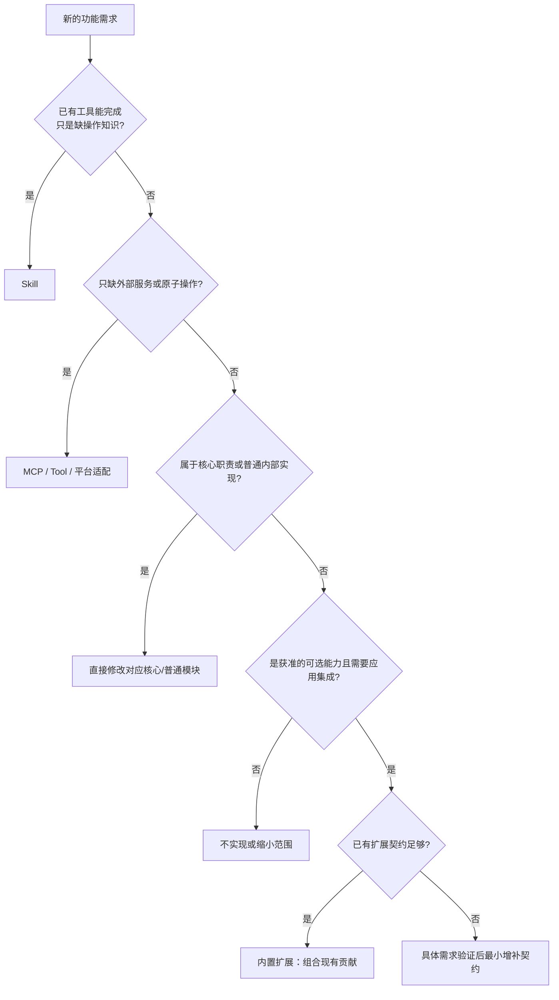
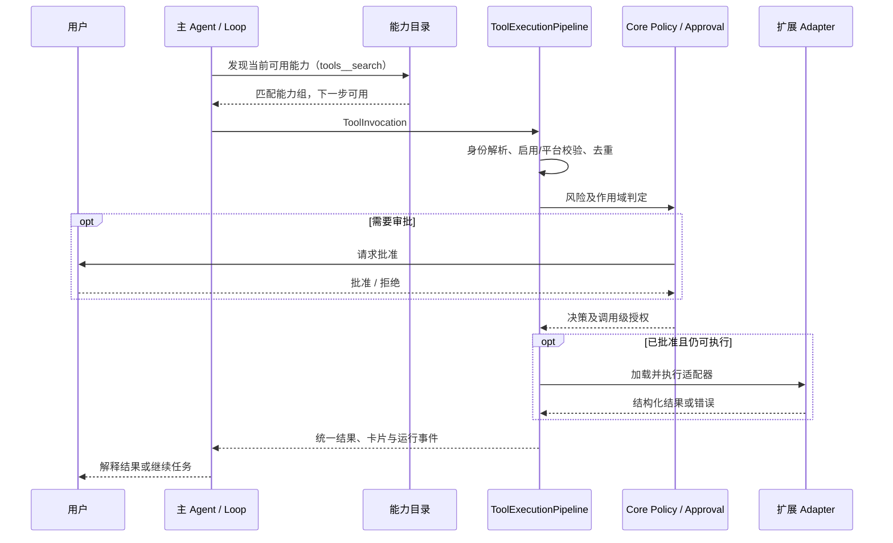

# Chatless 内置扩展机制：需求与实施规范

> 联合计划 v2.0 · 2026-11-25 · 文档 A（基础设施）  
> 适用对象：维护者、功能开发 Agent、架构审查 Agent、测试 Agent  
> 状态：落地中。PR A（契约、构建期注册表、导入边界门，#258）与 PR B（knowledge 试点迁移，#259）已合入 main；PR C（#260）按 §11 验收矩阵补上注册一致性测试（风险表/审批桶/展示 i18n 同址检查）与 §11.2 性能预算的回归测试，并同步文档。§10 阶段表中未动的部分：阶段 3 的执行器接线（贡献的 loadAdapter 接管执行路由）与阶段 4 运行时验收（启动/内存中位数、金丝雀）、后续能力迁移（工具结果、技能、应用市场）；文档 B（Session App）未开始。本文其余部分仍是目标设计与验收标准。

## 与 Session App 的联合实施决策（先读）

本文是联合计划的第一份文档，**替代 2026-11-24 的 v1.0**，保留其具体契约、边界、试点和 A01–A17 验收标准，并补充与第二份文档的关系。配套文档：[B · Session App 需求与运行时实施计划](session-app-plan.md)。两份应一同交给负责分析和实施的 Agent，不能把两者合并为一次大重构。

### 联合计划的目标

| 层级 | 解决的问题 | 信任边界 |
|---|---|---|
| Skill / Tool / MCP | 教 Agent 怎么做、给 Agent 执行能力 | 原有 Skill / 工具及权限机制 |
| 内置扩展（本文） | 可选系统功能如何不扰动核心地接入 | 官方审核、随主程序构建的可信代码 |
| Session App Runtime（文档 B） | 如何创建、加载、保存和演进应用型会话 | 可信宿主服务；对应用提供独立受限协议 |
| Session App（文档 B） | 个人应用界面、业务数据和 Agent 协作 | AI 生成或用户编写，默认不可信；不是内置扩展 |

开发顺序：A0–A4 最小内置扩展机制 → B0–B1 安全可行性验证和宿主骨架 → B2 饮食应用纵向闭环 → B3 生图工作台验证 → B4 Agent 创建/升级应用 → B5 发布与观测。A 的阶段 5 即 B 的真实新增能力验证。B0 的只读调研和隔离试验可以提前并行，但不能因此提前扩展生产 Core。A 完成的依据是 A01–A17 与性能门禁，而不是 B 的功能完成。

**Session App 是内置扩展机制的真实使用者，不是该机制的前置设计依据。** A 阶段无需预造 App 类型、路由系统、UI slots、数据库、IPC、通用 Service/Observer 或 SDK。B 确有需求时，只新增一个窄的、可测试的宿主接线点（例如会话工作区入口和按需初始化），不把 App 的 manifest、桥协议、数据管理、版本和安全沙箱变成所有 Extension 的公共契约。即使 B 最终采用普通模块加一处静态组装，也符合本文，只要关闭成本、依赖方向和权限边界通过验收。

尤其重要：不能让生成的 App 导入内部 Extension API、注册可信 ToolAdapter、修改风险分类或获得主 WebView 原生权限；它只能调用文档 B 规定的受限宿主接口。A 的依赖检查属于工程边界，不等同于对不可信 JS 的安全隔离。

若 B 发现 A 的接口不足，提交小型变更说明：真实场景、现有机制为何不足、最小契约、权限及生命周期、第二个适用例或避免重复抽象的理由、对应测试。不能为了 B 任意暴露 Core store/AgentRunner/数据库对象。A 失败或 B 安全试验失败时，暂停受影响阶段、保留既有功能；禁止绕过安全边界赶进度。

## 阅读导航

- [1. 决策摘要](#1-决策摘要)
- [2. 现状与问题](#2-现状与问题)
- [3. 功能归属及准入](#3-功能归属及准入)
- [4. 架构与依赖边界](#4-架构与依赖边界)
- [5. 第一阶段：能力注册契约](#5-第一阶段能力注册契约)
- [6. 运行过程、权限与生命周期](#6-运行过程权限与生命周期)
- [7. 完整示例与后续扩展点](#7-完整示例与后续扩展点)
- [8. 跨平台、配置、状态与用户体验](#8-跨平台配置状态与用户体验)
- [9. 控制复杂度的硬规则](#9-控制复杂度的硬规则)
- [10. 实施与迁移计划](#10-实施与迁移计划)
- [11. 验收标准与测试矩阵](#11-验收标准与测试矩阵)
- [12. 交付规范与开发 Agent 指令](#12-交付规范与开发-agent-指令)
- [附录：仓库依据](#附录仓库依据)

---

## 1. 决策摘要

Chatless 已经具备基础聊天和 Agent 能力。下一阶段的主要架构问题不是“怎样让应用加载任意插件”，而是“怎样增加可选高级功能，同时不让既有核心系统不断膨胀”。

**决定：继续采用模块化单体，在其内部建立小而明确的能力贡献（Contribution）机制。通过静态组装、按需加载和受控能力接口实现扩展，而不是构建动态插件平台。**

内置扩展与普通模块可以同属一个仓库、一个版本、一个应用包。扩展的特殊性不是独立目录，而是它可以通过已有契约被系统发现、使用、关闭、测试和移除，核心不依赖具体扩展的实现。

### 1.1 目标与非目标

| 要实现 | 不以此为目标 |
|---|---|
| 可选功能的接入逻辑集中，避免多处手工注册 | 全部代码搬进 `extensions/` |
| 核心只依赖能力契约，不认识具体扩展 | 核心代码从此永远不能修改 |
| 复用现有工具发现、授权、执行、结果、Skill 体系 | 重建工具或 Agent 框架 |
| 关闭功能后不发现、不执行、不启动其服务 | 静态构建下承诺绝对零包体成本 |
| 新功能可由开发 Agent 在有限范围内实现 | 为并行开发提前建设多 Agent 平台 |
| 按实际需求新增少量扩展原语 | 万能 Hook、事件总线、服务定位器、动态 SDK |
| 明确安全、平台、性能和失败边界 | 在同进程内承诺不可信代码沙箱 |

### 1.2 第一阶段交付范围

只实现**静态扩展清单、统一工具贡献、与现有 Skill 加载的最小集成、启用/可用性过滤、依赖约束及验证**。选择一个低风险、已存在的工具能力作为迁移样本，并用测试夹具证明第二个能力可通过相同契约接入。

后台服务、运行事件观察、界面插槽、Subagent 调度、主动感知等不属于第一阶段必做。只有被批准的真实需求无法通过现有能力解决时才增加对应接口。

如果审查发现已有机制足以满足试点需求，应直接完善已有机制，允许最终实现没有 `ExtensionManager` 类，甚至没有独立 extension-api 包。以验收结果而非类、文件夹数量判定成功。

### 1.3 设计成功的直观表现

假设将来增加一个“定时任务”功能，理想的改动范围是其私有实现、工具定义、配置、Skill、测试及一处组装清单。Agent Loop 不出现 `if (schedulerEnabled)`，通用工具执行器不出现 `if (server === 'scheduler')`，工具卡片不需要再手工补一张名称表，提示词不被硬编码进全局系统提示。

若确实缺少后台服务生命周期，则应单独说明为什么需要增加一个**通用、受约束的原语**，而不是把具体定时任务逻辑塞回核心。

## 2. 现状与问题

### 2.1 已核对的仓库事实

基于 2026-11-24 查阅的 `kamjin3086/chatless` main 分支部分文件（不是全仓审计）。具体调用链、文件行号、分支状态在实施前须重新核实。

复核记录：2026-11-26 在 main `62bc4de` 逐项核对上表——所列机制与路径全部仍存在，语义未变；该基线上 main CI 全绿（单元 1760 passed / 6 skipped，248 个测试文件）。原核对树 `0716bc9` 距当前 main 已有 18 个提交，各分支实施前仍须按阶段 0 重新固定。

| 现有机制 | 已有能力 | 本设计的要求 |
|---|---|---|
| `nativeTools/toolRegistry.ts` | `TOOL_GROUPS`、`ToolGroupId`、核心与按需工具分组 | 复用现有目录与按需加载，逐步消除新增能力必须修改固定 union/数组的问题 |
| `ToolsRegistryAdapter` | `tools__search` 搜索内置工具与启用的 MCP；下一模型步加载命中能力组 | 使发现、注入和运行时解析使用同一启用能力视图 |
| `ToolAdapter` / `createDefaultAdapters()` | 适配器执行接口、默认适配器列表 | 保留适配器；禁止新增第二套工具 dispatcher |
| `ToolExecutionPipeline` | 适配器注入、调用去重、授权、执行、结果及工具卡片处理 | 作为所有内置工具的统一调用入口 |
| `toolRisk.ts` | 风险分类、计划模式许可、可重放判定 | 继续由核心策略决定；迁移不能改变原有权限语义 |
| `McpAdapter` / `serverNamePolicy` | 外部 MCP 执行及内置名称区分 | 统一冲突检查，避免新扩展误走 MCP fallback |
| `toolCardPresentation.ts` | 工具卡片可读标题、详情和预览 | 支持同源工具展示元数据，保留统一卡片 UI |
| `SkillManager` / Skills | 现有 Skill 加载、发现、执行资产 | 复用，不创建第二个 Skill 管理器 |
| `AgentRunControlPlane` / `AgentRunEventStore` | 运行事件持久化、顺序分配、运行状态及恢复相关基础 | 后续需要观察运行时优先消费已有事件；不另建一份执行事实 |
| `src/app/extensions/page.tsx` | 已有 Skills / MCP 管理入口 | 有实际 UX 需求时复用，不先开发通用插件管理中心 |

### 2.2 为什么不能只是移动目录

普通模块化可以让文件整齐，但如果接入新工具需要分别修改目录、适配器列表、内置 server 名称识别、风险分类、提示词发现、工具显示名称、设置界面等多处，耦合仍然存在。

应消除的是“同一个事实必须在多处声明”。例如工具身份、所属能力组、展示名称、适配器所有权，应在贡献定义处集中声明；目录、执行路径和 UI 从同一事实派生。风险策略虽可消费声明，却仍然由核心裁决，不应让扩展自行决定权限。

### 2.3 与现有产品约束的关系

`docs/agents/constraints.md` 已明确轻量、本地优先、多模型、可选能力、默认关闭以及禁止为热点建设复杂框架；本提案强化这些要求，不替代该文档。现有 main 文档仍列移动端为当前不做，且 Subagent 等排在单 Agent 可恢复之后。维护者正在探索 Android 的实际计划若已改变产品方向，应单独更新权威约束；本提案不自动批准移动端、新后台能力、企业级编排或任何示例功能。

Skills、MCP、知识库在现有产品能力分层中属于官方可选包等既定类别；它们的加载/执行契约和现有功能默认值须保留。本文中的“Core”主要指负责调度和安全的基础设施，不代表将所有已有功能强行改成默认开启。

## 3. 功能归属及准入

### 3.1 先选择最低成本的实现方式



| 场景 | 优先选择 | 原因 / 不应做的事 |
|---|---|---|
| 教模型如何使用 Android 文件、理解授权失败、正确选工具 | Skill | 不为知识和经验建设流程引擎 |
| 访问 GitHub、Notion 或某个业务 API | MCP + Skill | 不为第三方服务维护一套原生扩展 SDK |
| 本地原生计时、文件选择、屏幕采集能力 | 平台 adapter + Tool（必要时内置贡献） | OS 权限和真实设备操作必须靠代码保障 |
| 工具卡片普遍更易读、流式渲染优化 | 普通模块 / Core | 不把基础产品维护伪装成可选扩展 |
| 可选自动化、任务提醒、应用级感知 | 内置扩展（需准入） | 需要状态、生命周期或用户交互，MCP/Skill 未必能独立完成 |
| 专门的游戏/行业工作流 | Skill + MCP，必要时少量集成 | 不把领域业务逻辑写进 Agent Loop |
| 审批、取消、模型选择、运行恢复 | 核心基础设施 | 最终控制权不能被各扩展分割 |
| 高级 Subagent、独立监督 | 可选 adapter / 扩展，后续验证 | 必须满足现有 harness 前置条件；本阶段不实现 |

### 3.2 功能申请（每个扩展一页即可）

提交者必须先说明：用户问题和实际任务；为何现有 Skill/MCP/普通模块不足；对应产品能力层；所需贡献种类；平台及授权；关闭后的成本；数据归属；失败降级；验证方案；负责维护人。至少符合现有功能准入规则，不能因为有了扩展接口就降低产品门槛。

如果一个能力只有私有算法、没有独立可用性、没有需要注册的资源或应用级接入，普通模块即可。不要把所有 service、组件、helper 都称为扩展。

## 4. 架构与依赖边界

### 4.1 逻辑结构

```text
                         用户 / 主 Agent
                              │
                    Core：会话、调度、审批
                              │
                ┌─────────────┴──────────────┐
                │  已有工具、Skill、状态基础设施 │
                └─────────────┬──────────────┘
                              │ 读取已启用能力视图
                      能力契约 / 贡献注册
                              ▲
                 静态组装入口（唯一接线位置）
                   ▲          ▲           ▲
                 扩展 A      扩展 B      扩展 C
                   │          │           │
                 私有业务实现 / 平台适配 / Skill
```

箭头表达能力接入关系；源码依赖规则另见下表。组装入口是允许同时依赖核心契约和具体扩展实现的地方，不是一个拥有全部运行状态的超级管理器。

### 4.2 依赖矩阵

| 发起方 | 可以依赖 | 禁止依赖 |
|---|---|---|
| 核心运行时 | 契约、核心服务、通用平台端口 | 具体扩展、扩展清单、扩展私有状态 |
| 扩展契约 | 最少必要的已有类型、纯类型及稳定领域接口 | UI 页面、具体扩展、全局 store 单例、业务实现 |
| 具体扩展 | 自身模块、公开契约、明确注入的必要服务、批准的公共工具 | 其他扩展私有代码、核心内部状态、任意 native invoke/SQL/权限改写入口 |
| 组装入口 | 核心公开组装 API、扩展描述与工厂 | 具体任务调度或业务流程、第二份权限策略 |
| UI 通用宿主 | 能力视图、展示契约、通用组件 | 每个扩展的特殊条件分支 |
| 平台 adapter | OS/native API、对应端口 | 反向调用 Agent Loop、操作全局会话状态 |

上述限制主要适用于新增扩展边界和迁移后的模块，不要求一次性清理全仓历史依赖。现有不可避免的过渡依赖应有记录与清理条件，不允许以“临时”为名持续扩散。

### 4.3 建议目录（逻辑示意，不要求大搬迁）

```text
src/lib/extensions/
  contracts.ts              # 少量贡献类型，可复用现有类型
  registry.ts               # 构建、校验、派生能力视图
  builtin.ts                # 唯一静态清单 / 组装接线
  <feature>/
    contribution.ts         # 描述符、工具、分组、必要的展示信息
    implementation.ts       # 私有实现；按需 import
    skills/                 # 如确需随功能发布的 SKILL.md 资产
    __tests__/              # 单元与契约测试
src/lib/mcp/                # 保留既有 Agent Loop / Pipeline / ToolAdapter
src/lib/skills/             # 保留既有 Skill 机制
src-tauri/                  # 保留原生 API 与平台权限边界
```

如果现有合适目录更符合仓库惯例，可直接在那里实现。不要新建 `core/` 并大批移动代码来满足示意图。扩展清单不能由核心反向 import，应在已有应用启动/服务装配入口显式传入；具体装配位置以代码审计为准。

## 5. 第一阶段：能力注册契约

### 5.1 关键抽象：Contribution，不是万能 Hook

扩展声明“我提供什么”，核心决定“哪些能力对当前平台和会话有效、何时展示、如何授权、怎样执行”。

| 原语 | 定位 | 本阶段 |
|---|---|---|
| Tool contribution | 工具定义、所属组、适配器/执行工厂及展示描述 | 必做；复用 ToolAdapter |
| Skill reference | 随扩展提供的已有格式 Skill，按需发现/读取 | 有试点需要时接入；不重造协议 |
| Enablement / availability | 启用状态、平台和条件，生成能力视图 | 必做 |
| Settings | 持久化功能偏好、必要配置 | 第一版复用现有设置；不造配置表单引擎 |
| Service | 后台/长期资源的启动与停止 | 延后，等具体批准需求 |
| Observer | 观察运行事件、提交受控反馈 | 延后 |
| UI slot | 在有限位置贡献界面 | 延后；工具卡片描述不是任意 UI slot |

### 5.2 参考契约（TypeScript）

以下为设计示意，不是要求逐字采用的可编译补丁；类型名优先复用已有 `McpTool`、`ToolAdapter`、`ToolRisk`、平台检测、设置与 Skill 类型。真实调用签名需按仓库核对。不要创建平行类型体系来追求图纸一致。

```ts
import type { McpTool } from '@/lib/mcp/McpClient';
import type { ToolAdapter } from '@/lib/mcp/pipeline/ToolAdapter';
import type { ToolRisk } from '@/lib/mcp/pipeline/policy/toolRisk';

type Platform = 'windows' | 'linux' | 'macos' | 'android';

type ToolPresentation = {
  titleKey: string;      // 现有 i18n key 或已验证的类型
  kind: 'generic' | 'query' | 'path' | 'url' | 'shell';
  detailArg?: string;    // 只能显示适宜公开给用户的参数
};

type ToolDeclaration = {
  definition: McpTool;  // 复用现有工具定义、参数 schema
  risk: ToolRisk;       // 描述性分类，绝不是授权决定
  presentation: ToolPresentation;
};

type ToolGroupContribution = {
  id: string;          // 稳定且不冲突，例如 'builtin.example'
  name: string;
  description: string;
  server: string;      // 保留现有 server + tool 身份规则
  tools: readonly ToolDeclaration[];
  loadAdapter: () => Promise<ToolAdapter>;
};

type BuiltinExtension = {
  id: string;
  defaultEnabled: boolean;
  platforms?: readonly Platform[];
  toolGroups?: readonly ToolGroupContribution[];
  // 仅当试点确需：复用现有 Skill 资源位置 / 加载方式
  bundledSkillRefs?: readonly string[];
};
```

约束：描述符必须轻量、无业务 I/O、无全局副作用。`loadAdapter` 工厂只在能力被调用且前置条件满足时触发，使用动态 `import()` 时注意构建产物。需要 native 或其他服务时由组装入口注入具体、窄接口，避免将整个应用对象、store、数据库句柄交给扩展。

例：某扩展需要只读设备信息，仅注入 `readDeviceInfo()`，不要注入 `tauri.invoke(command, args)`。注意：这是可信内置代码的工程约束，不是进程级隔离；原生层仍需独立校验。

### 5.3 唯一事实源及派生视图

描述符是工具所有权、身份、分组和展示事实的来源。注册表是其只读索引/快照，不另存一份相同事实。核心既有安全策略仍是权限裁决的事实源。

```text
静态清单 + 已有核心工具描述
           │
           ▼
  校验身份与冲突 / 构建索引
           │
           ├── 已注册名称：保留身份、判断内置所有权
           ├── 已启用且当前可用的能力：搜索/提示词/界面
           ├── 调用解析：精确身份 → 唯一适配器工厂
           └── 展示元数据：标题、类型、详情
```

必须区分**已注册**与**可执行**：关闭扩展时身份仍被保留，历史卡片仍可显示原有名称；但搜索、提示词和新调用不能暴露或执行它。不能因为关闭就把同名 server 交给外部 MCP。

现有 `ToolGroupId` 的固定 union 应在试点必要时调整为可扩展且可验证的 ID（保留既有组名、状态与行为），不以简单 `as any` 跳过约束。内置 core 组不可被可选扩展覆盖或删除。

`createDefaultAdapters()` 现有顺序具有意义（MCP fallback 等）。新增贡献的 adapter 要以精确身份匹配，不能靠遍历顺序抢占工具。应复用 Pipeline 的适配器契约，可由一个通用贡献适配器委派按需加载后的实现，或在现有查找处做最小改造；只能有一条最终执行路径。对已有内置 server 的别名/规范化、MCP 保留名都要做冲突测试。

### 5.4 注册、错误与状态

| 情况 | 规定行为 |
|---|---|
| 重复 extension/group ID | 在校验时拒绝；禁止后注册覆盖前注册 |
| 规范化后 server/tool 重名 | 拒绝冲突；禁止 fallback 抢占；记录具体 ID |
| schema 或元数据无效 | 测试/CI 失败；运行期隔离有问题的可选扩展，核心照常可用 |
| 扩展关闭 / 平台不支持 | 不对模型暴露；UI 可说明原因；直接调用拒绝且不加载实现 |
| Adapter 工厂失败 | 返回可读错误，记录诊断；不影响其他工具与聊天 |
| 扩展初始化并发 | 同一工厂在同一有效作用域只初始化一次；失败清除 pending 状态，受控重试 |

开发构建和 CI 对任何注册错误严格失败。生产环境可选扩展出现冲突时，应隔离冲突项（若与核心冲突则核心始终保留；两个可选扩展冲突则均隔离，避免顺序决定胜者）。核心自身损坏不得用静默降级掩盖。

不要为状态新增大型状态机。初期只需要描述符有效性、启用、平台/依赖可用，以及必要的加载结果；“enabled”不是“正在运行”。由已有设置/状态模块提供事实，注册表生成当前视图。

## 6. 运行过程、权限与生命周期

### 6.1 一次工具调用的完整路径



示意图中的顺序是目标约束，不代表当前 Pipeline 每个内部步骤均按此命名。特别是 adapter 匹配和实际加载/执行应分离，权限批准前不得执行副作用或隐式启动可选服务。批准后若启用状态、调用级授权或平台条件变化，执行边界必须再次确认。

### 6.2 安全不变量

- 用户启用扩展 ≠ 批准任何工具调用；Skill 中的指令 ≠ 授权；模型自行构造工具名称 ≠ 获得能力。
- 风险声明不能自行降低权限。核心安全策略依据已审查的能力、实际参数、作用域、现有规则作出决定。未知风险不得默认放行计划模式、免审批或重放。
- `risk: read` 不等于没有隐私风险，也不等于一定可重放；读屏、读本地文件、网络发送等须分别考虑。保留现有 `isPlanOnlyAllowed` / `isReplayableRead` 语义；扩展默认不获得额外例外。
- 文件路径、别名、目录允许名单、调用级授予和 Rust/native 校验继续由既有链路承担。扩展不得直接复用旧审批记录，不能自己伪造“已批准”。
- 扩展如果需要组合调用其他工具，应通过现有授权执行入口，不能直接调用其他 adapter 绕过审批。避免产生递归授权死锁；第一版不需要这种能力就不暴露。
- 取消、失败、超时、返回结果、审计归属仍由核心协调；写操作超时不应盲目自动重放。

### 6.3 第一版不做热卸载

启用/关闭是用户功能级语义，不等于 JavaScript 模块从内存卸载。推荐初版在安全边界应用设置：新调用立即拒绝已关闭能力；正在审批的请求在执行前重新校验；已开始的操作按照现有取消机制尽力停止或完成并明确反馈，不能承诺回滚已发生的副作用。

若现有系统不支持某类操作的可靠取消，限制能力范围或明确“关闭后对后续调用生效”，不为此擅自建设新的任务引擎。重启后应恢复启用设置，但不得自动重放有副作用的旧调用。

关闭后，历史记录、配置和用户数据默认保留。清空数据是独立且明确的用户操作。已经加载的模块代码留在进程缓存可接受；活跃的监听、定时器、网络连接、后台计算等资源不能无故继续运行。

## 7. 完整示例与后续扩展点

### 7.1 第一阶段示例：只读工具贡献

以下使用虚构的 `example` 只读示例说明接入流程，不要求新增一个没有产品价值的正式功能。正式迁移应挑选已有、风险边界清楚、无复杂原生依赖的可选工具组（例如知识查询的一个合适只读能力，经审计后选定）；保留其现有设置、名称与授权。

```ts
// extensions/example/contribution.ts
export const exampleExtension = {
  id: 'example',
  defaultEnabled: false,
  toolGroups: [{
    id: 'builtin.example',
    name: 'Example capability',
    description: 'Read information supplied by the example capability',
    server: 'example',
    tools: [{
      definition: {
        name: 'describe',
        description: 'Describe a provided item without external side effects',
        input_schema: { schema: {
          type: 'object',
          properties: { item: { type: 'string' } },
          required: ['item'],
        } },
      },
      risk: 'read',
      presentation: { titleKey: 'example.describe', kind: 'query', detailArg: 'item' },
    }],
    loadAdapter: async () => {
      const { ExampleAdapter } = await import('./adapter');
      return new ExampleAdapter();
    },
  }],
} satisfies BuiltinExtension;
```

```ts
// extensions/example/adapter.ts — 执行实现，不负责审批或 UI
export class ExampleAdapter implements ToolAdapter {
  readonly server = 'example';
  canHandle(call: ToolInvocation) {
    return call.server === 'example' && call.tool === 'describe';
  }
  async execute(call: ToolInvocation) {
    const item = call.args?.item;
    if (typeof item !== 'string' || !item.trim()) {
      return { ok: false, error: 'Invalid item' };
    }
    return { ok: true, item, length: item.length };
  }
}
```

真实实现须使用现有名称规范化和结果契约；上例省略导入和公共校验细节。工具参数 schema 不代替实际执行边界的输入验证。

```ts
// extensions/builtin.ts — 组装清单示意
export const builtinExtensions = [exampleExtension] as const;
// 在实际装配入口，将校验后的贡献交给已有工具目录/管线。
// 核心模块自身不 import 此清单。
```

开启后的路径：工具目录能搜到 `example.describe` → 按现有分组机制下一模型步加载 → Pipeline 判定权限 → 惰性加载 adapter → 返回结果 → 统一卡片显示本地化名称。

关闭后的路径：目录不再暴露 → 模型直接构造旧工具名仍被拒绝 → 适配器不加载 → 其他内置工具和 MCP 不受影响 → 历史卡片仍可读。

**应修改哪些文件？** 扩展自身、清单、必要的本地化资源及测试。新增第二个同类工具扩展时，不再修改通用 Pipeline、Agent Loop、风险判定逻辑、工具发现实现或卡片渲染分支。第一阶段为了建立公共接入点而对核心做的有限改动允许存在。

### 7.2 后续示例：定时任务（未纳入本期）

当真实需求获准后，可能需要在 Tool + Skill 之外增加长期服务原语。不要把它预先加入第一版契约。

| 功能 | 应归属 |
|---|---|
| 创建、查询、取消任务工具 | Tool contribution，走 Pipeline |
| 何时使用定时任务、如何表达计划 | Skill |
| 任务持久化、调度、时区和幂等 | 扩展私有逻辑 |
| 任务到期后请求 Agent 运行 | 核心提供明确的受控任务提交端口（若确有必要） |
| 权限、运行 ID、取消、资源限制 | Core / 既有基础设施 |
| 后台服务启停 | 经验证后新增最小服务生命周期 |

如果确实需要服务，先考虑一个明确的 `start(signal): Promise<Stop>` 契约，要求可重复安全启动/停止、部分启动失败自行回收、受控超时、退出时清理。生命周期必须有唯一拥有者，不能由各组件 mount 时偷偷启动。不得把普通工具的短时调用也包装成后台服务。

用户关闭功能时暂停待执行任务、取消尚未开始的工作，保留任务数据；恢复策略需单独批准。应用未运行或 OS 后台受限时不能承诺按时执行。触发任务不得绕开权限或将一次审批变成永久授权。

### 7.3 后续示例：Watchdog（未纳入本期）

观察现有 `AgentRunControlPlane` / `AgentRunEventStore` 产生的已提交事件；若需要新增观察接口，应从已有事件类型派生最小只读投影，避免引入第二套事实日志。

```text
Agent Run（拥有状态、序列、取消权）
   │ 已提交的、允许观察的事件投影
   ▼
Watchdog（独立判断）
   │ 报告问题：runId + evidence + suggestion
   ▼
核心/主 Agent 决策入口 → 忽略、提示、受控暂停或请求人工决策
```

监督者不能直接修改历史、模型上下文、运行状态或审批结论。观察回调不可阻塞核心关键路径；须有有界队列、超时、失败记录及过载策略。对同一 run 的反馈需要限频、去重、因果标识，避免监督者之间反复触发。是否采用持久观察、事件重放或更细粒度 Hook 由真实需求决定，而不是当前先造通用总线。

### 7.4 后续示例：Subagent（未纳入本期）

主 Agent 通过受控任务委派工具选择子 Agent、提供任务范围和最小上下文；子 Agent 返回产物和证据，主 Agent 负责验收和决定下一步。核心负责运行身份、授权作用域、取消及预算边界。不能把子 Agent 直接变成可以任意修改父会话的独立控制器。

优先考虑外部 agent adapter；等单 Agent 可恢复、审计、取消及隔离条件满足，再批准独立能力。不要借扩展机制搭建通用 swarm、workflow DSL 或分布式任务平台。

### 7.5 后续示例：Android 与设备上下文

平台提供真实可用的文件授权、设备操作或上下文采集端口；扩展描述可用工具；Skill 说明使用方法和局限；主 Agent 根据任务自主选择；核心审批管线和原生授权共同控制执行。没有 Android 能力时不能给模型一个必然失败的工具。

如果 Android 端已有静态平台工具，不必强行迁移为扩展。只有功能可选且有真实注册/隔离需求时才迁移。操作经验、常见错误及策略建议应尽量以 Skill 解决；权限、参数、取消、资源访问范围必须硬约束，不能交给 Skill 兜底。

## 8. 跨平台、配置、状态与用户体验

### 8.1 跨平台与性能

- 平台可用性依据真实运行时/编译能力，而不单靠 OS 名称；设备权限未授权时应按工具语义请求审批或返回可处理的缺失原因。
- 静态清单允许共享代码；桌面/移动差异由现有平台 adapter 和构建条件负责。禁止在共享入口顶层 import 不支持平台的 native 模块。
- 轻量描述与重量实现分离：关闭时不执行初始化、不启动后台资源、不请求网络、不创建额外数据库/索引，不增加模型工具 schema 或 Skill 正文。
- 动态 import 可能减少启动执行与初始 chunk，不保证减少安装包大小。若重量依赖导致包体不可接受，需要构建级可选包或 MCP 外部化，不是加 feature flag 就能解决。

### 8.2 配置与数据

复用当前设置系统。使用稳定 extension ID 作为命名空间，仅在确需独立配置时新增项；不要另建通用 KV 数据库或 JSON schema 表单框架。

新获准的实验能力默认关闭；迁移已有功能必须保持其原默认值、用户偏好和会话兼容性。关闭不删除历史、配置及产物；卸载/清除数据需独立设计。权限存储仍由既有授权模块负责，扩展不得把启用配置当权限记录。

扩展状态应尽量私有，只有必要的可读摘要通过明确契约暴露。需要独立持久化时复用现有 DB 迁移和事务机制；不要随意写核心表或创建跨扩展共享业务状态。

### 8.3 用户界面

现有 Extensions 页面已经包含 Skills 与 MCP；第一阶段不要求新增第三个通用插件管理页面。若试点有可选功能设置，则优先沿用已有设置或 Labs 入口，清晰显示启用、当前可用性、原因与影响。

- 模型按任务发现能力，而非用户必须先了解内部扩展名。
- 工具卡片沿用现有布局、审批按钮、结果与错误反馈；从统一展示元数据取得可读名称及安全详情。
- 不向用户展示内部 server 名作为正常标题；本地化缺失使用经过验证的可读 fallback，不泄露秘密参数。
- 后续只有存在两个真实共用位置或已明确的产品需求时，再增设有限 UI slot（例如设置区块），不得允许扩展修改任意界面树。

## 9. 控制复杂度的硬规则

### 9.1 抽象准入规则

每个新增公开扩展点必须回答：

1. 当前哪个真实需求无法由已有契约解决？
2. 为什么局部模块或一次性窄接口不够？
3. 输入、输出、所有权、调用时机、错误、取消、安全边界是什么？
4. 最简单的替代方案是什么，为什么放弃？
5. 如何用测试证明核心不被扩展反向控制？

首次需求优先具体实现；第二次对照共同需求；第三次考虑稳定抽象。不是僵化的次数限制：已存在多处明显重复注册或必要安全不变量，可以立即收口。没有真实需求的通用能力不准进入 API。

### 9.2 反例对照

| 不应采用 | 应采用 |
|---|---|
| `ExtensionContext` 暴露 `app/store/db/runner/invoke` | 最小类型化端口，按需显式依赖注入 |
| 核心 `switch(extensionId)` | 通用能力视图与精确契约派发 |
| 每个扩展各自注册审批逻辑 | 风险声明 + 既有核心裁决 |
| 全量注入所有高级工具和 Skill 正文 | 现有能力组搜索及渐进披露 |
| 新建通用 Hook 总线并插入每个函数 | 需要时提供语义明确的观察接口 |
| Observer 直接改历史、取消标志、授权 | 提交建议/请求，由核心决策 |
| 大量 `activate()` 中隐藏业务启动行为 | 轻量声明，实际工作按需启动 |
| 靠目录约定、README 或开发 Agent 自觉 | 可执行 import 边界和契约测试 |
| 为插件而插件；所有功能都移走 | 普通模块继续普通开发 |
| 为外部生态设计 SDK/版本协商/热重载 | 同仓、同版本、静态清单 |
| 自动扫描模块、反射加载、插件相互依赖图 | 明确注册；共享的能力确需复用时用普通公共模块 |
| 以 feature flag 宣称零包体 | 测量启动、内存、chunk 和实际产物 |

### 9.3 复杂度预算

第一阶段仅允许一个逻辑组装入口、一个逻辑能力索引（可直接完善现有工具注册表）、一个既有执行管线、一个既有 Skill 体系、一个既有权限裁决体系。不得为新扩展增加独立通用运行时、第三方框架依赖、新数据库或 IPC 协议。

新增机制必须替代重复接入或满足明确的验收项。如果只增加了注册层而旧的多处手工注册仍存在，迁移尚未完成；过渡期间仅允许同源派生的兼容视图，禁止双写。

维护者若发现某个设计无法控制依赖、性能或复杂度，可选择保留普通模块，放弃扩展化。回退是正确的工程选择，不是架构失败。

## 10. 实施与迁移计划

不要在同一个 PR 中既重构 Agent Loop，又建立扩展机制，又开发新高级功能。按以下顺序交付；每一步保持可构建、可测试，且可以单独回退。

| 阶段 | 实施工作 | 完成条件 |
|---|---|---|
| 0：基线审计 | 阅读项目约束、ADR、现有目录/权限/模型双轨调用链；记录现有行为、性能和测试基线 | 明确试点组、调用链、现有注册点、授权行为和影响范围 |
| 1：最小契约 | 建立轻量贡献描述、校验、静态组装与可用能力视图；先写冲突/关闭/依赖测试 | 不引入第二套 registry/dispatcher；核心行为未改变 |
| 2：试点迁移 | 选一个已存在的低风险可选能力，将定义、分组、展示、适配器接入统一贡献 | 工具名、参数、结果、默认值、审批和历史卡片保持兼容 |
| 3：补齐一致性 | 同一视图驱动发现、工具注入、调用解析及名称保留；复用 Skill 入口，补齐失效处理 | 不存在“模型能看到但执行不了”或“关闭后仍能执行”的幽灵能力 |
| 4：架构门禁 | 增加依赖检查、第二扩展夹具、生命周期及资源测试；完成文档 | 夹具不改通用核心即可接入；全部 P0 验收通过 |
| 5：实际验证 | 用一个获准的真实新增能力验证收益；比较改动范围和资源成本 | 确有收益再逐步迁移其他模块；否则简化或回退 |

### 阶段 0：实施前必须交付的审计记录

1. 固定当前基准 commit SHA，检查工作树是否干净，明确并行工作所有权。阅读 `AGENTS.md`、`docs/agents/constraints.md`、`CODING_STANDARDS.md`、相关 ADR 和维护规范。
2. 跟踪实际工具链：工具目录 → 搜索 → group load → prompt/native 注入 → tool 解析 → adapter → policy/approval → 结果与 UI。检查存储、缓存、保留名和默认适配器的所有消费者。
3. 查清 Chat 和 Agent 双模式、native 与 prompt tool-call 双轨、计划模式、外部 MCP fallback、会话切换、停止与授权拒绝行为。不得只测单一路径。
4. 选定试点：优先已有只读可选能力，不选 shell/文件写入/删除/审批作为首次迁移。记录原有 ID、名称、参数、设置、权限、可重放行为及相关测试。
5. 运行第 11 节基线测试，记录成功/失败与已知问题；未能执行的测试明确标记。确定最小接入点后再写生产代码。

### 阶段 1–4：建议 PR 切分

- PR A：契约、构建注册视图及依赖检查；用测试夹具证明基本语义。没有用户可见新功能。
- PR B：迁移试点及其消费者，保留兼容入口（若需要），删除已被替代的独立手工声明。覆盖安全与双轨回归。
- PR C：集成测试、性能对照、开发指引；只有必要时调整已有可选能力设置界面。

若 A/B 必须原子修改才能保持可编译与一致性，允许合并，不人为拆出半成品。每次 PR 使用实际 repo 约束，不因本规范而绕过既有评审流程。

### 兼容与回退

- 工具 ID、原有 group ID、i18n key、存量配置和会话数据无必要不改；确需更名时提供显式迁移与兼容测试，不能静默重置。
- 不使用长期双注册。过渡兼容接口由新/旧唯一事实源派生，并有明确移除条件。
- 不改变数据库 schema，除非试点本身已有充分需求且另行审查。首期注册机制应能在无数据迁移的情况下回退。
- 若出现权限回归、基础路径性能显著下降或实现复杂度超过收益，应暂停后续功能，先修复或回退引入的接线。

## 11. 验收标准与测试矩阵

### 11.1 P0：必须全部通过的发布门禁

每一项都要关联自动化测试或可重复验证步骤。不能用“代码看起来符合设计”代替结果。

| ID | 验收条件 | 测试与证据 |
|---|---|---|
| A01 | 核心不直接依赖具体扩展 | 新边界的 import/依赖图检查；覆盖 `@/` alias、相对路径、barrel re-export、动态 import；组装入口明确例外 |
| A02 | 新同类扩展无需改核心 | 第二个测试扩展仅增夹具定义、注册条目、资源与测试；无需修改 Loop、Pipeline 主流程、审批策略、发现和卡片分支 |
| A03 | 唯一注册事实 | 对同一个工具，从目录、发现、注入、执行解析、展示视图读取一致的身份/所有权；重复 ID、规范化碰撞、保留名冲突均拒绝 |
| A04 | 默认关闭与平台过滤 | 新可选能力未开启或平台不支持时，不进入搜索和 prompt/native schema，adapter 工厂调用次数为 0 |
| A05 | 关闭后的直接调用阻断 | 手工构造或重放关闭扩展的工具名，明确拒绝；无执行、无外部 MCP fallback、无副作用 |
| A06 | 权限不退化 | 允许/需要审批/拒绝场景对比旧版；拒绝时 adapter 执行次数为 0；未知风险不获免审批或计划模式放行 |
| A07 | 审批等待竞态安全 | 批准前关闭能力、切换条件或取消 run；最终不得执行已失效请求，不留下调用级授权 |
| A08 | 已有安全语义保留 | 路径允许名单、别名、once/always/unrestricted、计划模式、可重放和写操作失败行为与基线一致 |
| A09 | 发现与注入一致 | `tools__search` 命中后按原逻辑下一模型步加载；关闭/平台变化后旧会话缓存不能恢复禁用能力 |
| A10 | native 与 prompt 双轨兼容 | 同一试点在两种轨道下完成发现、参数解析、审批、执行、结果；无工具能力时原降级仍正常 |
| A11 | 失败隔离 | 试点 adapter 工厂抛异常、返回失败或超时；基础聊天、其他内置工具及外部 MCP 仍可用，错误可诊断 |
| A12 | 基础行为回归 | 全部可选新能力关闭时，Chat/Agent 双模式、流式、停止、会话恢复和既有工具结果不回归 |
| A13 | 生命周期与并发 | 连续启用/关闭、并发首次调用、初始化失败后重试；无重复初始化、额外监听、悬挂 pending；新调用不越过关闭边界 |
| A14 | 用户体验及历史 | 卡片使用可读本地化名称；审批与错误不变；关闭后历史、数据与配置保留；秘密参数不进入标题/日志 |
| A15 | 配置兼容 | 迁移现有用户设置、旧会话 group load 状态、工具身份；重启后恢复原设置，未授权操作不会自动执行 |
| A16 | 无第二套框架 | Review 与依赖 diff 证明未增加新 runtime、全局总线、重复工具/Skill 管理器、无关第三方依赖 |
| A17 | 自动化质量门禁 | `pnpm verify` 及相关现有验收通过；任何失败列出原因，不得标注为通过 |

A02 是关键验收。不得仅验证“新增扩展符合接口”却仍需为它增加核心 `if/else`。如需额外安全审查，允许增加该工具的可信风险分类数据，但不得为同类工具新增独立授权流程或特殊权限分支；若风险数据仍需多处维护，应在报告中说明为何不能安全收口。

### 11.2 P0：性能与资源预算

以下是本提案建议的初始工程门槛，**不是实测结果**。阶段 0 在相同机器、构建配置和数据集上确认测量方法；若基准波动超过阈值，需要提高重复次数或测量精度，不得事后无说明放宽门槛。

| 指标（可选扩展均关闭） | 验收目标 | 测量方法 |
|---|---|---|
| 额外服务、网络、监听、定时器、DB 初始化 | 0 个来自禁用扩展的活跃资源 | spy / 运行时资源计数、日志；重复启停 |
| 禁用扩展业务模块加载 | 0 次业务工厂执行；重量实现不进入初始执行路径 | 工厂 spy、构建产物/模块分析 |
| 基础模型输入成本 | 新增扩展的工具 schema 和 Skill 正文为 0；无新增常驻提示词块 | 对比相同会话的 prompt 与 schema 快照（排除时间等动态字段） |
| 启动时间 | 中位数相对基线增加不超过 5%，且绝对增加不超过 100ms | 同机器冷启动各至少 10 次；记录中位数、p95 和原始数据 |
| 稳态进程内存 | 中位数相对基线增加不超过 5%，且绝对增加不超过 10 MiB | 相同空闲条件、相同采样时机，记录应用及相关子进程 |
| 包体 / 初始 chunk | 注册机制本身不引入重量依赖；初始 JS gzip 体积增量建议 ≤ 20 KiB | 对比 production build，列出实际包体与 chunk diff |
| 查找与校验 | 不引入每次模型步的全量重建或网络检查 | 测量 1/10/50 个轻量贡献；确认热路径使用已有索引，记录 p95 |

性能数值使用**同时满足**相对和绝对限制的规则。对移动端等不同设备应单独建立基线；静态打包可能保留扩展代码，不以“安装包绝对零增量”作为不可能的承诺。若涉及重量原生依赖，应另定包体预算并由维护者批准；第一阶段本身不允许引入该类依赖。

### 11.3 P1：未来原语出现时才启用的门禁

| 原语 | 必须额外验证 |
|---|---|
| Service | 启动失败清理、重复启停、退出/关闭时资源回收、后台限制、超时与恢复策略、幂等执行 |
| Observer | 不阻塞主流程、队列有界、过载/异常隔离、最小事件数据、事件顺序与重复处理、无权直接修改运行状态 |
| UI Slot | 插槽有限、关闭后消失、组件异常不影响主界面、键盘与触屏兼容、无任意全局 UI 注入 |
| Subagent | 父子运行归属、权限不升级、上下文隔离、模型/并发预算、取消传递、结果验收及可追踪性 |
| 原生/跨平台能力 | 平台不可用时不暴露；原生授权与前端规则双重验证；在目标设备实测，不仅 mock |

### 11.4 建议的测试组织及运行命令

测试文件命名按现有 Vitest 和目录惯例执行，以下为建议测试组而非现存文件名。

```text
registry.contract.test.ts         # 唯一性、规范化、可用性、派生视图
extension.boundaries.test.ts      # import 规则与例外
extension.discovery.test.ts       # search、group load、native/prompt 注入
extension.execution.test.ts       # Pipeline、权限、直接调用、取消、fallback
extension.lifecycle.test.ts       # 惰性加载、失败、并发、关闭后资源
extension.presentation.test.ts    # 卡片与历史、本地化、参数脱敏
extension.integration.test.ts     # 第一、第二贡献的端到端验证
```

现有 repo 支持的验证命令（实施时再次核对）：

```bash
pnpm repo:state
pnpm typecheck
pnpm typecheck:tests
pnpm test
pnpm verify:fast
pnpm verify
# 仅在对应验收资产存在且适用时：
pnpm test:acceptance
```

`pnpm verify` 已包含 fast 验证与 production build，日常可先运行针对性测试和 fast 验证，提交前跑完整门禁。涉及 native 改动时还须运行仓库适用的 Rust 检查、原生构建和真机验证，不能仅凭前端测试判定通过。

### 11.5 统一验收记录模板

| 字段 | 填写内容 |
|---|---|
| 基准/目标版本 | baseline SHA、target SHA、平台与工具链 |
| 验收项 | A01–A17、资源预算、适用的 P1 条目 |
| 状态 | PASS / FAIL / NOT RUN / N/A（N/A 必须说明原因） |
| 证据 | 测试名、实际命令、退出码、运行日志、截图或性能原始数据 |
| 差异 | 基线结果、变更结果、剩余风险、例外批准人 |

所有适用 P0 必须 PASS 才能宣布完成。无法运行的必测项标 NOT RUN，不能当作通过。未实现的未来原语可 N/A，不影响第一阶段完成。

## 12. 交付规范与开发 Agent 指令

### 12.1 新扩展开发的标准流程

后续开发者或 Agent 不必重读全仓；先阅读本规范、项目约束、当前贡献契约及一个已验证示例，然后按照以下流程工作：

1. 完成功能准入判断，选择 Skill、MCP、普通模块或内置扩展；不因已有扩展框架就默认选择扩展。
2. 列出使用的贡献种类、平台、权限、设置、数据和失败边界。明确是否需要新增公开契约。
3. 先编写最小独立实现和契约测试，再在唯一组装入口接线。Tool 走现有 Pipeline，Skill 走现有加载机制。
4. 验证开启、关闭、平台缺失、失败、授权拒绝、取消、历史兼容及资源成本。
5. 提交变更范围、架构例外、运行测试证据和回退方案。若需要修改核心，说明这是公共契约缺陷还是具体功能特判。

### 12.2 可直接交给实施 Agent 的任务说明

> **任务：** 基于当前 Chatless 代码，在不重写 Agent Harness、不开发外部插件平台的前提下，实现本规范第一阶段的最小内置扩展机制。先完成阶段 0 审计和试点选型，再实施统一贡献描述、静态组装、现有工具目录/执行/展示集成、可用性过滤和依赖测试。保持现有模型双轨、权限、会话、Skills/MCP 及平台行为。必须以第二个测试贡献证明新增同类功能不需要修改核心逻辑。
>
> **范围限制：** 不实现动态加载外部插件、热卸载、通用 Hook、服务总线、UI 插槽、Subagent、Watchdog 或 Scheduler 正式功能；除非维护者另行批准，不扩大产品功能范围，不批量搬迁目录。示例代码仅为契约说明，实际实现优先复用仓库类型及服务。
>
> **交付：** 代码、自动化测试、架构依赖门禁、一个可照做的扩展示例、现有注册点替代对照、实测资源数据、A01–A17 验收记录、剩余风险与回退说明。按现有 AGENTS.md 和维护规范运行验证；不能执行的测试如实报告。不得以新类数量或接口数量作为完成指标。

### 12.3 Review 最终判断

维护者可以用三个问题决定是否接受此架构：

- 下一次新增同类能力，开发者是否真的少读、少改了旧代码？
- 扩展关闭、报错或失去平台支持时，核心是否仍然安全、轻量、可用？
- 相比普通模块化，这层机制是否消除了真实的重复接线和控制权混乱，而不是增加了一层名称漂亮的抽象？

如果答案不明确，优先缩小契约、去掉未用抽象或退回普通模块化。Chatless 的最终目标仍是一个可靠的轻量通用 Agent，而不是一个功能数量庞大的插件运行平台。

---

## 联合计划交接清单（A → B）

A 完成后，向 B 实施者交付以下实际结果，而非仅交付设计稿：

| 交接项 | 必须说明 |
|---|---|
| 当前契约 | 实际导出路径、注册示例、如何获取当前会话的可用能力、启用/关闭时机 |
| 工具执行 | native/prompt 双轨、发现、身份校验、审批、取消、结果与历史处理的实际入口 |
| 可选能力 | 默认关闭、惰性加载、平台过滤、失效行为、禁用资源统计 |
| 边界 | 允许的依赖方向、组装入口例外、测试门禁；说明这不是 App 的沙箱 |
| 验证 | 基准及目标 SHA、A01–A17、性能原始数据、已知风险、回退方式 |
| 遗留 | B 是否需要新的窄接线点；尚未实现的原语明确记为未实现，不当作已可用能力 |

不要将 B 所需的 UI 工作区、App 专属工具作用域、持久化或沙箱纳入 A 的验收范围。B 在自己的阶段按需实现并验证；若需要调整 A 的已经验证过的公共契约，必须补齐 A 的相关回归测试。

## 附录：仓库依据

以下是本提案查阅的源码和项目规范入口（main 链接会随仓库更新；实施前需固定实际 SHA）：

- [AGENTS.md](https://github.com/kamjin3086/chatless/blob/main/AGENTS.md)
- [产品约束与 Harness 演进](https://github.com/kamjin3086/chatless/blob/main/docs/agents/constraints.md)
- [GLOSSARY.md：权限、策略、工具语义](https://github.com/kamjin3086/chatless/blob/main/GLOSSARY.md)
- [工具注册与分组](https://github.com/kamjin3086/chatless/blob/main/src/lib/mcp/nativeTools/toolRegistry.ts)
- [工具目录搜索](https://github.com/kamjin3086/chatless/blob/main/src/lib/mcp/pipeline/adapters/ToolsRegistryAdapter.ts)
- [ToolAdapter](https://github.com/kamjin3086/chatless/blob/main/src/lib/mcp/pipeline/ToolAdapter.ts) / [默认适配器组装](https://github.com/kamjin3086/chatless/blob/main/src/lib/mcp/pipeline/adapters/index.ts)
- [统一工具执行管线](https://github.com/kamjin3086/chatless/blob/main/src/lib/mcp/pipeline/ToolExecutionPipeline.ts) / [工具风险分类](https://github.com/kamjin3086/chatless/blob/main/src/lib/mcp/pipeline/policy/toolRisk.ts)
- [MCP fallback](https://github.com/kamjin3086/chatless/blob/main/src/lib/mcp/pipeline/adapters/McpAdapter.ts)
- [工具卡片展示](https://github.com/kamjin3086/chatless/blob/main/src/components/chat/toolCardPresentation.ts)
- [AgentRunControlPlane](https://github.com/kamjin3086/chatless/blob/main/src/lib/mcp/agentLoop/AgentRunControlPlane.ts) / [AgentRunEventStore](https://github.com/kamjin3086/chatless/blob/main/src/lib/mcp/agentLoop/AgentRunEventStore.ts)
- [SkillManager](https://github.com/kamjin3086/chatless/blob/main/src/lib/skills/SkillManager.ts) / [Skills 架构文档](https://github.com/kamjin3086/chatless/blob/main/docs/skills-architecture.md)
- [现有扩展页面](https://github.com/kamjin3086/chatless/blob/main/src/app/extensions/page.tsx)
- [package.json：验证命令](https://github.com/kamjin3086/chatless/blob/main/package.json)
